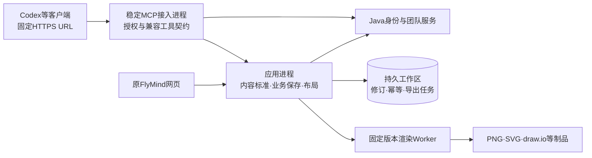

# MCP 持久接入与服务端更新方案

日期：2026-10-20。状态：方案与源码审查完成，升级机制待实施/验收；尚无正式域名和公网服务。本文件不改变当前本机连接，不发布新版本。

用户本日追加：本方案合入[v1.1线上协同一期](releases/V1_1_PLAN.md)，且已明确v1.1必须包含同图多人实时编辑。本文的独立远程接入切片可先验证，但不能据此从v1.1范围删除实时协同、团队空间、操作记录和批量导入；完整版本验收以v1.1计划为准。

## 1. 产品决定

推广主入口采用**固定 HTTPS 地址的远程 MCP**。客户首次添加地址并完成账号授权，以后由维护者更新云端业务服务、内容标准和 draw.io 渲染供应。客户不需要下载新的绘图包、修改 Node 路径或逐次改 MCP 配置。

公共地址固定为 `https://flymind.example.com/mcp`，其中域名仅为保留示例，正式域名上线前确定。沿用协作分支已实现的 `/mcp`，不把应用发布号、Git分支、安装目录或引擎号放入 URL。OAuth issuer 固定为正式域名根地址，resource 固定为该域名的 `/mcp`；发现元数据保留标准well-known路径，三者不是同一个URL。不能靠HTTP重定向随意变更授权身份。

这是**云端工作区**：新图、业务内容、原生 XML、历史和制品均保存在云端，网页与 MCP 修改同一份数据；无需客户启动本机应用。原工作台UI及内容/渲染分层继续保留。本机单用户/离线版本独立保留，现有图形不自动上传、合并或删除。迁移必须由用户显式选择导出/导入，并能核对源数据。

若用户要求数据永远留在本机，则完整引擎仍需本机安装和升级；云端只更新规则无法替换已安装的排版/浏览器代码。该用户群可后续增加签名自动更新器，不能宣传为“纯云更新且数据完全本地”。

## 2. 客户只做一次的操作

正式服务上线后，用户在客户端填写固定地址，登录自己的 FlyMind 账号并选择授权空间。Codex 支持远程 Streamable HTTP 和 OAuth。[OpenAI官方接入说明](https://learn.chatgpt.com/docs/extend/mcp?surface=cli)

以下为**未部署的示意**，不能作为当前可用安装命令：

```toml
[mcp_servers.flymind]
url = "https://flymind.example.com/mcp"
```

CLI同等操作：`codex mcp add flymind --url https://flymind.example.com/mcp`，再 `codex mcp login flymind`。令牌交由客户端OAuth凭据机制管理，不给所有客户分发同一API Key，不在URL或公开配置中放密码/长期令牌。

已有本地用户需要**一次性**改为远程入口并重新授权。首次切换前显示“即将进入云端工作区，本地数据仍保留”；云端列表为空不代表本地图形丢失。以后正常服务更新不要求重新填地址。账号撤权、授权过期且无法刷新或客户主动退出，仍需再次登录；这不是软件包升级。

## 3. 哪些更新由云端承担

| 更新对象 | 服务端处理 | 客户体验 |
|---|---|---|
| 绘图标准、示例、节点预算、质量检查 | 作为同一规则发布包部署 | 下次读取规则/提交图形使用生效规则，无需安装 |
| 自动布局、连线、模板、配色默认值 | 更新应用/渲染服务 | 新建和显式重排使用新策略，原人工图不偷偷重排 |
| draw.io、字体、Chromium | 更新固定且校验过的供应包 | 由服务端生成图片，客户不下载引擎 |
| 网页功能与外观 | 发布同源网页，静态资源带内容hash | 正常刷新加载；有未保存编辑时提示，不强制重载画布 |
| 新增工具/工具参数 | 保持旧契约可用，按需通知重取工具列表 | 旧工具继续可用；新能力是否立即显示取决于客户端 |
| 协议/鉴权不兼容变更 | 在接入层提供兼容适配并明确支持期限 | 不能承诺第三方客户端永远无需升级或重新授权 |

正常更新的承诺是**不用更新客户配置和绘图安装包**，不是无条件保证第三方客户端永不重连、永不重新登录。用户自己的 Codex/客户端仍由该产品维护。

## 4. 更新架构：接入连接与绘图进程分开



1. **稳定MCP接入进程**只承载 Streamable HTTP、OAuth、权限绑定、工具声明和应用调用适配。频繁变化的规则/渲染代码不驻留在该进程的模块常量中；`get_drawing_guide` 从当前应用服务取权威规则。升级绘图服务不必终止客户端MCP连接。
2. **应用进程**持有内容校验、原生投影、CAS、幂等回执、工作区保存和导出调度；内部API不对公网开放。权限仍逐请求检查；内部身份凭证/服务认证不能来自客户自报userId、teamId或数据路径，也不能把任意上游token透传到其他服务。
3. **渲染Worker**使用不可变的 draw.io/适配器/字体/Chromium 供应。业务内容没有坐标，坐标和手工编辑保留在渲染层。任务绑定实际供应，不随部署瞬间换引擎。
4. 首期沿用按团队隔离的SQLite与持久卷，应用层保持**单活写入者**；MCP网关无权直接打开这些文件。不能为滚动升级让多副本同时挂载同一SQLite工作区并冒充集群。MySQL/Redis继续用于已确定的Java控制面。
5. 接入层升级较少，绘图层升级较多。先把已有工厂和连接适配抽成两个启动单元，不重写工具业务，不同时恢复实时多人协同路线。

现状提醒：冻结协作分支的MCP和应用目前仍在同一Node装配中；原生guide的部分字段/校验器为启动时加载。仅覆盖Markdown会产生“新说明、旧校验器”，**现有代码尚不具备本节隔离和热发布能力**。

## 5. 长期兼容契约

### 5.1 地址、工具和规则分开版本

- 公共URL固定 `/mcp`；FlyMind工具契约用内部 `contractVersion=1` 标识，不与MCP协商的协议日期、应用版本或内容标准版本混用。
- 保留现有工具名、既有必填字段、结果状态和错误语义。新增输入字段应可选、带兼容默认值；不得突然要求旧客户端多填一个参数。新增输出字段也要通过旧schema验证器，不能一概认定“可选就兼容”；旧会话维持原输出投影，或在首发契约中预设可扩展容器。真正不兼容的新能力用新工具/新内容版本并保留旧适配；不通过改所有客户URL完成升级。
- 工具描述及初始化instructions只保留稳定工作流：“先读guide，纯内容，修改先读最新revision，冲突不覆盖”。不将频繁变化的完整规则和具体标准号硬编码在每个工具描述里。
- 服务端使用的规则、schema、校验器、样例与说明构成同一不可变 `policyBundle`，记录 `standardVersion`、`rulesHash` 和支持的内容版本。一次业务请求开始时固定该包，validate/保存/导出不能在中途切成另一套规则。
- 新接入契约的guide预设 `contractVersion/standardVersion/rulesHash/releaseId/capabilities` 的兼容表达；已有严格schema的会话不直接追加未允许字段，版本元数据通过原guide文本或已声明扩展容器提供。变严的质量规则若拒绝旧输入，返回节点/连线问题与当前规则入口，不写库、不伪造成功；AI读取当前guide后修正。
- 服务端无法抹掉AI已经读取的旧上下文，因此“规则生效”以当前服务器检查为准，而非保证模型立即忘记旧规则。

### 5.2 工具缓存

工具清单变更时发送 `notifications/tools/list_changed`，让支持该通知的客户端重新获取清单。该通知属于发现机制，不能代替旧契约兼容，也不能据此承诺每种客户端都会即时刷新。[MCP工具规范](https://modelcontextprotocol.io/specification/2025-11-25/server/tools)

规则/布局修复不改变工具schema时，无需每次要求客户Restart。新增工具在部分客户端中可能要重新连接或新开会话才能显示，原工具仍应正常工作。

## 6. 发布、排空与回滚

1. 生成不可变服务制品及发布清单：`releaseId + contractVersion + policyBundleHash + adapterVersion + engineResourceKey + migrationLevel`。应用升级、标准升级与数据迁移分别记录。
2. 在隔离测试空间运行五类标准样例、混型/长字负例、历史人工几何兼容、真实PNG和旧工具payload回归；目标OS的字体/浏览器供应必须真实验证。
3. 预热新绘图服务只使用临时/只读数据，不同时向生产SQLite写入。授权发现、固定resource与制品URL也进入发布检查。
4. 网关进入短暂绘图维护状态：已开始的写入/渲染完成或按持久任务状态收敛，新业务请求返回可重试的明确状态及等待提示；MCP连接保持。不盲目重放结果未知的写请求。
5. 停止旧应用写入者，启动新应用并接管持久队列；健康与读取检查通过后，网关切到新实例。失败则恢复原制品并继续使用原兼容数据库。固定的客户端URL和授权主体不变。
6. 首期灰度在测试团队/独立数据副本验证，再切单活生产应用；不在同一SQLite卷上“蓝绿同时写”。数据库采用先扩展后收缩；不可逆迁移单独维护和恢复，不宣称切回代码就能回滚数据。
7. 若升级的是MCP网关本身，停止分配新会话并排空旧实例；支持多网关时按session黏连到其所属实例。内存会话不能在重启后假装仍存在。失效会话按协议处理，真实客户端须验证重新初始化和重试表现，必要时允许用户重新连接，地址不变。[MCP传输规范](https://modelcontextprotocol.io/specification/2025-11-25/basic/transports)

**写入/任务约束**：requestId及幂等回执跨应用重启持久保留，相同授权空间内相同请求不重复建图；请求ID不进入全局跨团队命名空间。授权通过后先核对既有回执，再对未执行的新请求做当前质量检查，保留当前native服务的该顺序。旧payload的规范化、默认值、actor命名空间及摘要算法须兼容；releaseId/policyBundleHash作为回执元数据，不能混入旧请求摘要使原requestId变成冲突。`expectedRevision`保持CAS；遇冲突先读再合并。发布窗口中的未知写入结果通过原requestId及相同payload核对，不能换ID重建。

**已生成图形**：历史XML、人工位置和不可变制品不自动重绘。新布局只影响新建或用户显式重排。导出任务绑定原revision、内容/XML快照、规则与引擎供应；升级后继续读取原制品，重试旧任务要找到对应供应，不可偷偷换成新图。

上述供应绑定是**待实施要求**：现有任务已保存快照/options，但renderer仍由当前服务注入，尚未持久绑定policyBundleHash/engineResourceKey。U05需补任务版本元数据、旧供应分派及缺失供应时的明确错误。现有project校验严格匹配当前engine/adapter，还需历史版本读取/导出适配及独立迁移；仅保留旧XML不等于升级后必然能读、能导出。

## 7. 云端交付图片与链接

- MCP继续返回真实PNG图片块及 `saved/exportStatus/jobId/revision`，超时继续查询原任务，不重复创建。
- 响应和图片沿用明确的大小预算；不能内联时提供可读取的真实制品，不以远程HTTP为由无限堆入base64或删改源图。
- 云端返回受保护的HTTPS编辑/下载链接及MCP资源URI；不能给远端用户返回服务器磁盘路径，不能返回 `127.0.0.1` 编辑链接。
- `diagramId/revision/exportId/format` 稳定定位制品。读取资源每次校验用户/团队权限；临时签名链接绑定制品、短有效期并有重新获取入口，不在链接中放长期Bearer token。
- 制品文件名和mtime固定使用该次exportedAt；重复下载同一制品不刷新服务器文件时间，不修改图形创建/更新时间。浏览器本地下载文件的创建时间由客户端管理；需要新导出时创建新的exportId，保留原制品。
- 网页更新不强制刷新正在编辑的画布；先保存/处理草稿，再在安全切图或主动刷新时加载兼容的新静态资源。旧页面与后端兼容窗口纳入发布检查。

## 8. 可复用成果与缺口

只读审查基于 `codex/cloud-collaboration-20261020` / `e5ad1e84`，质量规则来自当前质量分支，不能直接部署冻结分支覆盖新标准。

| 事项 | 当前事实 | 下一步 |
|---|---|---|
| 远程 `/mcp` 与OAuth | 冻结分支 `server/cloud/http.ts/oauth-provider.ts/oauth-mcp.ts` 已装配，SDK+PNG使用Java HTTP替身验证 | 复用，完成真实控制面和客户端验收 |
| 用户/团队和空间隔离 | Java权威、逐请求状态复核、按teamId摘要映射工作区已有切片 | 真实MySQL/Redis、停用/撤权/恢复验证 |
| 授权批准网页 | 后端有consent路径，工作台缺少批准UI闭环 | 补薄授权页，不重做原工作台 |
| 远程交付结果 | 冻结cloud复用native delivery，仍可能直接输出服务器绝对files路径 | U04剔除远程磁盘路径，改为受保护HTTPS URL/MCP资源；本地STDIO结果保持兼容 |
| 规则更新 | 当前统一标准1.1通过本机质量验收，仍为进程代码 | 同步合入远程服务，建立同包规则与动态guide |
| 稳定网关/绘图服务隔离 | 尚未实现 | 拆启动和内部连接，保持现有业务服务 |
| 排空/回滚/制品兼容 | 不可变任务/修订已存在；没有任务供应持久绑定、旧供应分派或完整发布机制 | 增发布清单、任务版本与历史适配、维护状态及升级演练 |
| 正式部署 | 无服务器/正式域名，Linux供应未完整验收 | 先形成可部署制品，实际部署目标准备后上线 |

远程接入切片可以独立准备，但v1.1整体发布须同时通过C03同图实时协作及新增团队/导入/操作记录验收。支付和完整本地自动更新器不纳入本期。现有本地Runtime的Host/Origin/工作区认证保护继续保留，不直接取消保护暴露公网。

## 9. 实施顺序与验收

| 批次 | 实施范围 | 通过条件 |
|---|---|---|
| U01/U02 | 固定双代理只读源码/契约审查 | 已完成，事实和边界已写入本文件；没有启动服务/改变用户库 |
| U03 | PM形成持久接入ADR、更新契约与范围 | 本文及ADR002已形成；这是方案交付，不是云端可用声明 |
| U04 | 复用远程MCP、补授权薄页与身份收口，适配远程制品URL，合入质量1.1 | 真客户端首次授权→五类绘图→PNG/网页修改同图；无服务器磁盘路径泄露，真实鉴权/撤权通过 |
| U05 | 稳定网关与绘图服务隔离、规则包/发布清单、任务供应绑定与历史适配、排空恢复 | 同一客户端连接升级前后可用；旧queued/retry使用原供应，缺供应明确拒绝；未改配置、重复建图或丢修订 |
| U06 | 可部署包、维护者发布/回滚文档及完整升级演练 | 目标环境真实部署/重启、持久授权、任务继续、旧输入/旧网页兼容及回滚验证 |
| U07 | 正式域名/TLS发布、客户一次性接入 | 服务端实际公网调用与客户安装流程通过，才替换推广文档 |

上线前至少独立验证：①相同配置连续两次升级；②正在导出的任务；③保存成功但响应中断后的幂等重试；④旧工具schema调用；⑤新guide与校验器hash一致；⑥相同团队空间及旧修订；⑦退出/撤权后的资源拒绝；⑧两团队同ID隔离；⑨更新失败恢复；⑩当前Codex实际重连/新工具刷新行为。不能仅凭SDK单测宣称客户无需操作。

## 10. 明确不采用的推广主路径

- 每次要求客户更新Git/安装包或手改绝对路径：可留开发/离线文档，不满足托管更新目标。
- 仅将命令改成 `npx ...@latest`：仍需下载和重启，并受包缓存/长驻旧进程影响；不等于云端升级。
- 启动本地代理再转发云端：保留了代理自身分发、兼容和升级成本；远程HTTP原生支持的客户直接连接。
- 只远程覆盖Markdown：新规则说明与旧执行代码会分离，无法保证绘图质量一致。

后续开发以此为新增边界，与冻结分支契约合并后执行；不在本轮文档工作中擅自切换本机MCP、上传用户图形、推送代码或更新应用版本。
