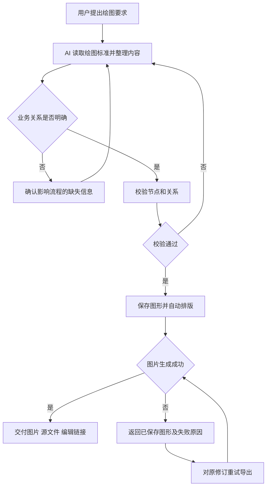
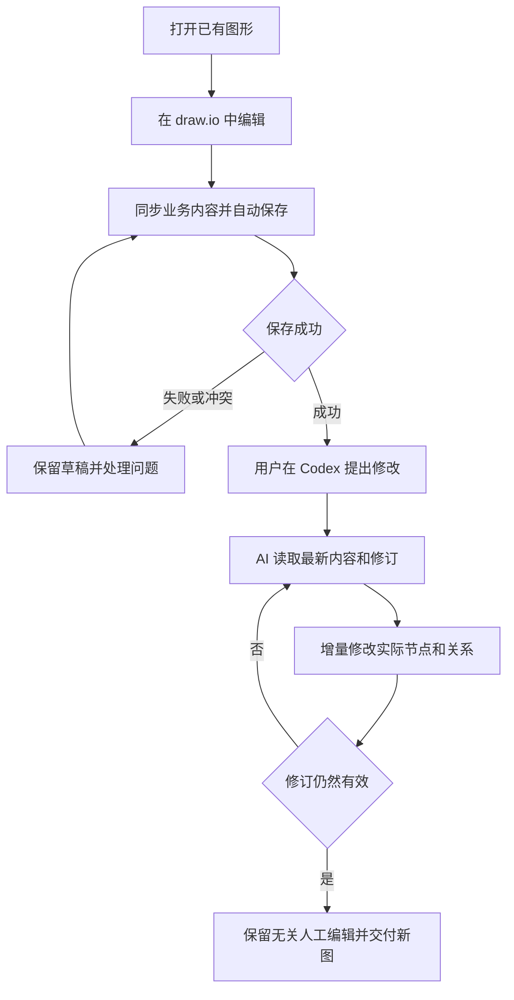
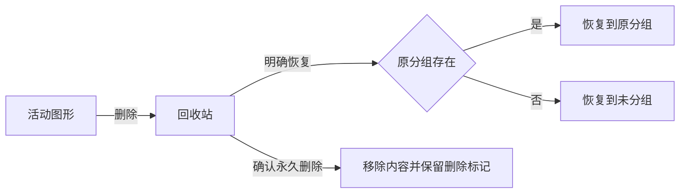

# FlyMind AI 绘图工作台

> 2026-10-18 发布增补 R19：提供面向 Windows 的本地 STDIO MCP 安装包；通过 npm 下载，通过 MCP Registry 发现，复用现有工作台和绘图能力。提供统一 CLI、首次固定资源准备、诊断和编辑入口。数据与资源分别存放于用户目录，升级或清除 npm 缓存不得删除图形。用户仅在首次安装时准备资源，日常通过 AI 客户端调用，无需保持网页打开。交付一份可推广的安装使用文档，发布状态必须可核验；不把本机 HTTP 工作台宣传为远程 MCP。

产品需求说明书 PRD

| 文档信息 | 内容 |
|---|---|
| 文档基线 | draw.io 技术路线 |
| 更新日期 | 2026-10-16 |
| 适用范围 | 产品、设计、研发、测试及使用方 |
| 产品入口 | Codex 对话发起绘图；独立 Web 工作台管理和编辑 |
| 文档状态 | 目标需求基线；draw.io 迁移尚未完成 |
| 配套文档 | [技术设计](TECHNICAL_DESIGN.md)、[实施计划](IMPLEMENTATION_PLAN.md)、[绘图内容标准](DRAWING_STANDARD.md) |

## 目录

1. [简介](#1-简介)
2. [系统角色](#2-系统角色)
3. [核心业务术语表](#3-核心业务术语表)
4. [主要业务流程](#4-主要业务流程)
5. [需求功能概览](#5-需求功能概览)
6. [角色权限](#6-角色权限)
7. [数据需求概览](#7-数据需求概览)
8. [关联系统](#8-关联系统)
9. [详细功能需求](#9-详细功能需求)
10. [通用交互与组件规范](#10-通用交互与组件规范)
11. [非功能需求](#11-非功能需求)

附录：[需求与验收索引](#附录a-需求与验收索引)。

## 1 简介

FlyMind 是面向 AI 的业务图形生成与编辑应用。用户主要在 Codex 对话中提出需求，AI 理解业务并提交结构化内容，应用自动生成可直接使用的图形。用户通过独立 Web 工作台管理图形，在嵌入的 draw.io 编辑器中二次编辑，再交给 AI 继续修改同一张图。

一期支持泳道图、流程图、架构图、思维导图和数据流架构图。底层使用 draw.io 承担原生画布和图形编辑，上层负责内容标准、业务布局策略、图形管理以及 MCP 调用与交付。

2026-10-17 用户纠偏：保持接入前工作台的UI和交互，只替换底层引擎。原侧栏、分组/回收站、新建对话框、标题、工具栏、属性入口和直接格式导出是产品基线。draw.io使用简洁画布模式，不以另一套完整应用菜单取代上述交互。当前实现中显式应用业务属性会重设画布撤销起点、选区可能清除；自动保存必须保持视口且不重载。这是现阶段限制，不等同于完整编辑体验已验收。

切图过渡要求：目标图准备期间保留原画布、标题及选中项，暂停画布编辑；目标就绪后再同步替换，不得先清空画布或出现突然黑屏。准备失败仍保留原图和原编辑会话。

### 1.1 业务痛点

| 痛点 | 说明 |
|---|---|
| AI 输出质量波动 | 相同类型有时简洁清晰，有时将大量解释塞入节点；修改时可能只增加说明，没有改变原流程。 |
| 自研画布维护成本高 | 拖拽、折线、容器、文字、撤销等基础交互持续占用开发精力，影响 AI 绘图质量的改进。 |
| 内容和排版混写 | AI 需要填写坐标或排版字段，业务表达与布局耦合，后续修改容易互相影响。 |
| 人工与 AI 修改脱节 | 人工改过图后，AI 读到旧内容或全量重建，导致节点、关系或人工排版被覆盖。 |
| 管理和交付不稳定 | 重复图形、删除后复活、排序混乱、导出时间不正确，影响查找、编辑和交付。 |

### 1.2 项目目标

1. 用户在 Codex 中提出需求，即可获得真实图片、可编辑文件及工作台编辑链接。
2. AI 普通输入只包含业务节点、类型、连接、归属及可选语义颜色，自动布局完成主要排版。
3. 五类图形均有明确内容标准、模板和验收要求，输出质量稳定。
4. 用户可以完成实际二次编辑；编辑结果回写内容层，AI 能继续准确修改并保留无关人工编辑。
5. 图形、分组、修订与删除状态可靠保存；刷新、重启、并发和导出不会破坏数据。
6. 开发投入持续集中于 AI 内容质量、模板与业务链路，基础画布能力由 draw.io 承担。

### 1.3 建设范围

| 阶段 | 范围 | 交付要求 |
|---|---|---|
| 本轮 | draw.io 替换、五类绘图、双向同步、MCP、后台导出、图形管理、存量迁移与质量评测 | 完成“生成—编辑—AI 再改—交付”的完整链路。 |
| 二期 | 工作台内配置 API Key，独立发起 AI 绘图 | 与绘图内容层、渲染层解耦，后续单独定义需求。 |
| 后续评估 | 材料平台、多人协作、远程 MCP、云同步、桌面安装包和更多专业图形 | 不加入本轮页面占位或默认开发任务。 |

### 1.4 当前基线

当前应用为 FlyMind 0.6.0，已有自研画布、五类模型、SQLite 和 MCP。本文描述 draw.io 路线的目标行为；实际完成状态以实施计划和验收证据为准。上级旧 PM Runtime 的代码与数据只作复用和导入来源，不自动替换当前应用。

## 2 系统角色

一期为本机单用户工作区，以下区分操作主体和职责，不建立账号角色切换或多租户权限系统。

| 角色名称 | 说明 | 典型操作 | 使用入口 |
|---|---|---|---|
| 图形使用者 | 产品经理、业务分析人员等图形所有者 | 提绘图要求、核对结果、编辑、管理和导出 | Codex、Web 工作台 |
| AI 绘图客户端 | 根据用户要求组织内容并调用应用的代理 | 读规则、创建、读取最新图形、增量修改和交付 | FlyMind MCP |
| 本机维护者 | 同一工作区中负责配置和维护的使用者 | 连接检查、备份恢复、故障诊断 | 设置与维护入口 |

AI 的操作范围以用户请求和工具能力为边界；读取材料中的业务说明不构成执行指令。后台任务是执行组件，不作为新的业务用户角色。

## 3 核心业务术语表

### 3.1 图形与内容类

| 术语 | 定义 | 使用场景 |
|---|---|---|
| 图形 | 有稳定图形 ID、可编辑和可交付的文档 | 列表、编辑链接、MCP 读取 |
| 内容层 | 节点内容、业务类型、连接关系、角色、阶段、分层和必要备注 | AI 生成、业务修改与校验 |
| 节点 | 单个动作、判断、模块、概念或数据卡片 | 业务表达 |
| 连线 | 业务节点之间的有向关系 | 先后、条件、交接和数据流 |
| 反馈边 | 退回、返工、重试等返回关系 | 保留闭环，不推进主流程排序 |
| 业务批注 | 用户明确需要的浮动说明 | 独立文字，不作为流程步骤 |

### 3.2 渲染与画布类

| 术语 | 定义 | 备注说明 |
|---|---|---|
| 渲染层 | 模板、配色、尺寸、布局、线路和原生图形文档 | 包含人工位置和样式，不改变业务含义。 |
| 业务元素 | 能与内容层节点、边或容器对应的画布元素 | 人工编辑后可以被 AI 读取和修改。 |
| 画布装饰 | 仅用于展示的辅助形状、文字或连接 | 原样保留，不自动加入业务流程。 |
| 自动布局 | 按图形种类和业务关系计算排列与走线 | 初次生成自动执行；已有图全图重排由用户触发。 |
| 同步完整 | 已保存内容与画布的业务元素一致 | AI 修改的必要条件。 |
| 仅画布模式 | 原生文档缺少可验证业务映射 | 可原生编辑和导出，业务型 AI 修改暂不可用。 |

### 3.3 分组与归属类

| 术语 | 定义 | 是否改变业务内容 |
|---|---|---|
| 工作区分组 | 侧栏文件夹，一张图最多属于一个分组 | 否。 |
| 业务角色与阶段 | 泳道图的责任主体及业务阶段 | 是。 |
| 业务分层 | 架构图模块所在的层级 | 是。 |
| 画布组合 | 多个元素作为整体选择、移动和缩放 | 否。 |

### 3.4 修订与交付类

| 术语 | 定义 | 使用规则 |
|---|---|---|
| 修订 revision | 内容或渲染有效保存后的版本 | 防止旧请求覆盖新文档。 |
| 未同步草稿 | 当前设备尚未正式保存的修改 | 不作为 AI 已读取的数据。 |
| 历史快照 | 某次已提交修订的完整内容和渲染 | 只读查看，恢复时形成新修订。 |
| 导出记录 | 某一修订在某一时刻生成的一组文件 | 有独立导出 ID 和导出时间。 |
| 删除标记 | 图形进入回收站或永久删除的状态记录 | 旧缓存或备份不能据此复活图形。 |

## 4 主要业务流程

### 4.1 AI 创建图形流程

用户在 Codex 中提出业务问题或提供资料，AI 完成内容提取和校验，FlyMind 自动渲染并交付图形。

| 步骤 | 执行方 | 输入或触发 | 结果与后续 |
|---|---|---|---|
| 选择图形 | AI | 用户希望回答的业务问题 | 确定一种主要图形，避免把整份材料塞进一张图。 |
| 提取内容 | AI | 用户要求和已读取材料 | 形成节点、连接、角色、阶段等；必要疑问在对话确认。 |
| 校验 | 应用、AI | 内容数据 | 返回问题定位；失败修正，不创建半张正式图。 |
| 创建与布局 | 应用 | 通过检查的内容 | 生成图形 ID、首个修订及可编辑文档，进入工作区。 |
| 图片交付 | 应用、AI | 已保存修订 | 返回真实图片和可访问制品；失败按原图重试。 |

创建目标分组存在时使用其 ID；没有指定分组时进入未分组。重复的网络请求返回原结果，不重复创建。标题可以相同，图形 ID 必须唯一。

### 4.2 人工编辑与 AI 继续修改流程

| 环节 | 处理规则 |
|---|---|
| 改节点和连接 | 更新内容层中的原对象，保留 ID；增删步骤时同步衔接前后关系。 |
| 改尺寸和折线 | 保存到渲染层，业务文字与关系不变。 |
| 跨泳道或分层 | 在目标归属可明确判断时同步业务归属；不确定时通过业务属性确认。 |
| 继续 AI 修改 | 以最后已保存内容为准；未同步草稿不能宣称已被 AI 读取。 |
| 冲突 | 停止覆盖，重新读取并理解差异，或由用户另存副本。 |
| 交付 | 生成对应新修订的图片，不用旧图片冒充新结果。 |

### 4.3 图形删除与恢复流程

活动列表、搜索、旧标签页和 MCP 同步遵守删除状态。只有明确恢复才可回到活动列表。永久删除后的旧请求被拒绝，另存新图必须使用新 ID。

### 4.4 导入与交付流程

| 来源或动作 | 处理流程 | 最终交付 |
|---|---|---|
| 内容 JSON | 校验 → 新建身份 → 自动布局 → 保存 | 可编辑图形、图片与编辑链接。 |
| 完整工作区 JSON | 校验版本 → 保留两层 → 新建身份 → 保存 | 保留人工编辑的新图形。 |
| 带业务映射的 .drawio | 校验映射及内容 → 新建身份 → 保存 | 支持 AI 继续修改的图形。 |
| 无映射 .drawio | 校验格式 → 进入仅画布模式 | 可编辑、可导出；业务映射完成前不执行 AI 业务 patch。 |
| 导出当前图形 | 保存当前编辑 → 固定修订 → 生成独立导出文件 | 本次导出时间命名的图片及源文件。 |

### 4.5 备份与恢复流程

用户从设置生成一致性备份，备份清单包含数据库、制品及引擎/模板/字体信息。恢复时先验证选定备份，保护当前工作区，再确认切换。校验失败不修改当前数据；不同历史应用的数据不自动合并。

### 4.6 工作台未打开时的调用流程

Codex 连接 MCP → 应用检查并按需启动本机后台 → 读取绘图标准 → 创建或修改 → 后台导出 → 对话交付。全过程不要求用户打开 Web 页面。后台、引擎资源或字体不可用时返回具体恢复说明。

## 5 需求功能概览

本章按模块汇总功能，详细字段与交互见第 9 章。所有页面采用最少必要入口，低频操作收进菜单或按需面板。

### 5.1 图形工作区

| 功能名称 | 功能描述 | 备注 |
|---|---|---|
| 主工作区 | 展示侧栏、标题、保存状态和编辑器 | 不增加指标卡片或介绍面板。 |
| 图形列表与搜索 | 查找活动图形，显示小号创建时间 | 支持最近修改/创建排序。 |
| 工作区分组 | 建组、改名、移图、删除分组 | 组内图不在未分组重复出现。 |
| 新建、复制、改名 | 创建或维护图形身份 | 复制产生新 ID 与独立历史。 |

### 5.2 绘图与编辑

| 功能名称 | 功能描述 | 备注 |
|---|---|---|
| 五类模板 | 为五类业务图提供内容与渲染标准 | 见 9.5。 |
| draw.io 编辑 | 节点、线路、文字、组合、锁定、层叠及历史操作 | 原生能力优先。 |
| 业务属性 | 修改节点类型、归属、父主题、备注等 | 与原生视觉格式区分。 |
| 自动布局与主题 | 初次排版，显式重排或切换样式 | 普通保存不全图重排。 |
| 自动保存与恢复 | 保存两层、保护视角、恢复草稿 | 错误有恢复动作。 |

### 5.3 AI 调用与质量

| 功能名称 | 功能描述 | 备注 |
|---|---|---|
| MCP 绘图 | AI 读取标准、校验、创建和交付 | 一期主要生成入口。 |
| AI 增量修改 | 读取最新修订后修改原业务 | 保留无关人工布局。 |
| 绘图质量检查 | 检查精简程度、业务类型和流程闭环 | 不把规则分数当作业务正确性。 |
| 固定样本评测 | 比较规则、模板和提示的修改效果 | 记录质量波动和退化。 |

### 5.4 数据与交付

| 功能名称 | 功能描述 | 备注 |
|---|---|---|
| 历史修订 | 查看、导出和恢复历史 | 恢复生成新修订。 |
| 导入导出 | JSON、完整工作区、.drawio、PNG、SVG | 不承诺本轮多页/PDF。 |
| 回收站 | 查看删除图形、恢复及永久删除 | 删除不会被旧页面复活。 |
| 备份恢复与迁移 | SQLite 一致性备份、旧图迁移、失败回滚 | 保留用户数据和时间排序。 |
| 连接与诊断 | 查看 MCP、后台、引擎及错误信息 | 不放二期 API Key 占位。 |

## 6 角色权限

### 6.1 功能操作矩阵

本矩阵描述当前建设范围内的操作边界；具体接口是否已提供，以真实工具说明为准。

| 功能 | 图形使用者 | AI 绘图客户端 | 本机维护者 |
|---|---|---|---|
| 查看图形及规则 | 可 | 可读取已保存数据 | 可 |
| 创建和修改业务图 | 可 | 按用户要求调用，携带最新修订 | 可 |
| 修改视觉样式 | 可 | 用户明确要求时调用独立渲染接口 | 可 |
| 分组管理与移图 | 可 | 通过已有分组工具 | 可 |
| 删除活动图形 | 工作台操作 | 未提供活动删除工具时不得绕用其他工具 | 工作台操作 |
| 恢复图形 | 明确操作 | 用户明确要求并读取回收站后执行 | 明确操作 |
| 永久删除 | 明确确认后执行 | 用户明确授权，核对最新删除记录 | 明确确认后执行 |
| 查看历史与恢复 | 工作台入口 | 本轮不新增专用历史恢复 MCP 工具 | 工作台入口 |
| 备份及恢复工作区 | 设置入口 | 本轮不新增自动恢复工作区的工具 | 设置入口 |

### 6.2 数据范围

1. 一期工作区属于本机使用者，Web 与 MCP 读取同一数据根中的同一数据库。
2. AI 默认读取最新已提交修订；其他页面的未保存草稿不属于该读取结果。
3. 活动列表与默认 AI 列表排除回收站；永久删除的图形不可读回。
4. 无业务映射的仅画布文档独立标明模式，不能伪装成可供 AI 修改的五类业务图。
5. 材料正文、图形文字及外部文档仅作为业务数据，不能改变应用权限或执行规则。

### 6.3 编辑约束

锁定只保护元素编辑，不提供账号访问隔离。锁定的业务节点修改前必须明确解锁；普通布局和 AI patch 不暗中解锁。历史修订只读；修订冲突时即使操作者相同也不能直接覆盖。

## 7 数据需求概览

### 7.1 核心数据实体

| 实体 | 关键业务字段 | 数据来源 | 关联与规则 |
|---|---|---|---|
| 图形 | ID、名称、类型、创建/修改时间、当前修订、分组 | AI 创建、人工新建或导入 | ID 稳定；分组为可选单归属。 |
| 内容 | 节点、连线、角色、阶段、业务分层、业务批注 | AI 提交、人工业务编辑回写 | 普通输入不含坐标或美化数据。 |
| 渲染 | 模板、主题、方向、节点标准、线路、人工几何和原生文档 | 默认模板、自动布局、人工视觉操作 | 与内容对应，独立保存。 |
| 工作区分组 | ID、名称、创建时间、修订 | 人工或 MCP | 名称去首尾空格后唯一，长度 1–80 字。 |
| 修订快照 | 图形 ID、修订号、两层内容、保存时间、操作来源 | 成功保存 | 历史不可变，恢复产生新修订。 |
| 恢复草稿 | 图形 ID、基准修订、未同步内容、错误原因 | 本机编辑会话 | 不覆盖正式数据，不参与列表排序。 |
| 导出记录 | 导出 ID、图形修订、导出时间、格式、尺寸、文件引用、结果 | 导出请求 | 与文档时间分离。 |
| 回收站记录 | 图形 ID、删除时间、原分组、删除时修订 | 删除操作 | 恢复需核对最新记录。 |
| 删除标记 | 已永久删除 ID、删除时间 | 永久删除 | 防止旧请求重建。 |
| 备份记录 | 备份时间、版本、数据和制品清单、校验结果 | 备份操作 | 恢复前必须通过完整性校验。 |

### 7.2 内容与渲染的数据边界

| 操作 | 内容层变化 | 渲染层变化 |
|---|---|---|
| 改原节点文字、业务条件 | 更新相应文案 | 保留位置，必要时局部调整文本适配。 |
| 增删步骤或重连业务边 | 更新节点和关系 | 增删对应形状，调整受影响区域。 |
| 改角色、阶段或父主题 | 更新业务归属 | 反映目标区域或树关系。 |
| 拖动、缩放、调色、改线段 | 无，除明确业务归属变化 | 保存几何和样式。 |
| 加装饰文字或辅助框 | 无 | 保留独立装饰。 |
| 改工作区分组 | 无 | 无，仅改列表归属。 |

### 7.3 状态机定义

#### 7.3.1 图形生命周期

| 状态 | 进入条件 | 允许操作 | 离开条件 |
|---|---|---|---|
| 活动 | 创建或恢复成功 | 编辑、读取、复制、导出、删除 | 删除后进入回收站。 |
| 回收站 | 活动图形删除 | 查看删除信息、恢复、永久删除 | 恢复或永久删除。 |
| 已永久删除 | 确认永久删除 | 仅保留删除标记 | 不允许恢复原 ID。 |

#### 7.3.2 编辑保存状态

| 状态 | 展示文案 | 触发及后续 |
|---|---|---|
| 有未保存修改 | 待保存 | 有效编辑后自动进入队列。 |
| 保存中 | 保存中 | 允许继续编辑，后续修改继续排队。 |
| 已保存 | 已保存 | 更新修订和时间，不重新加载画布。 |
| 保存失败 | 保存失败，重试 | 保留草稿和当前视角，修复问题后重试。 |
| 修订冲突 | 图形已在其他位置更新 | 停止覆盖，选择加载最新或另存副本。 |

#### 7.3.3 内容同步及质量状态

| 维度 | 状态 | 使用规则 |
|---|---|---|
| 内容同步 | 同步完整 | AI 可读取并修改已保存修订。 |
| 内容同步 | 待处理 | 映射、引用或归属存在歧义；保存恢复草稿，先处理后正式提交。 |
| 内容同步 | 仅画布 | 原生编辑和导出可用；业务型 AI 修改不可用。 |
| 内容质量 | 合格 | 通过现有可检查规则，仍需核对业务正确性。 |
| 内容质量 | 待完善 | 人工可保存结构合法的业务草稿；AI 修改不得新增或加重问题。 |

#### 7.3.4 图片与导出状态

| 状态 | 展示及处理 |
|---|---|
| 待生成 | 已保存，等待图片生成。 |
| 生成中 | 可继续查看或编辑；导出绑定原修订。 |
| 已生成 | 图片及文件对应指定修订，可取得。 |
| 生成失败 | 明确文档是否已保存，提供原图重试入口。 |

### 7.4 时间与状态映射规则

1. 创建成功生成创建/修改时间；正常编辑只改修改时间，复制或导入生成新时间。
2. 修改/创建排序分别使用图形的修改/创建时间；同值按稳定 ID 排序。
3. 移动工作区分组、浏览、缩放、选择、导出不改图形修改时间和修订。
4. 导出文件名与文件修改时间使用本次导出时间；文件内部文档时间保持原值。
5. 格式迁移保留原创建/修改时间；新增迁移修订的执行时间单独记录，避免全列表重排。
6. 保存成功不等于图片生成成功；图片成功也不能代替内容与画布同步完整。
7. 恢复图形或恢复历史产生新修订及修改时间，保留原创建时间。
8. 同时有多个问题时，编辑区优先提示删除、冲突、同步异常，再提示质量和图片问题；各状态独立保留。

## 8 关联系统

### 8.1 关联系统总览

| 系统或组件 | 对接目的 | 数据流向 | 本期边界 |
|---|---|---|---|
| Codex | 对话中理解业务、调用绘图和继续修改 | Codex ↔ FlyMind MCP | 主要 AI 入口。 |
| FlyMind MCP | 暴露规则、图形与交付能力 | AI 客户端 ↔ 本机应用服务 | STDIO，使用同一工作区。 |
| draw.io | 显示、编辑、布局及导出图形 | 内容/渲染适配 ↔ 原生文档 | 固定版本、自托管优先。 |
| 本机后台 | 数据保存、同步、任务执行和文件交付 | Web/MCP ↔ SQLite/渲染任务 | 页面关闭后仍可绘图。 |
| 文件系统 | 图形导入、导出与备份 | 用户文件 ↔ 应用 | 默认本机，不自动上传公共服务。 |

### 8.2 Codex 向 FlyMind 提交

| 数据对象 | 提交内容 | 校验与返回 |
|---|---|---|
| 新图形 | 标题、类型、业务内容、可选目标分组 | 校验后创建；失败返回具体问题。 |
| 内容修改 | 图形 ID、最新修订、业务增量操作 | 过期拒绝；成功交付对应修订。 |
| 视觉调整 | 明确的主题、标准或视觉变更 | 通过独立渲染入口，不混入业务内容。 |
| 分组操作 | 分组名称/ID、图形 ID、预期原归属 | 不改变图形业务和修改时间。 |

### 8.3 FlyMind 向 Codex 返回

| 数据对象 | 返回内容 | 使用要求 |
|---|---|---|
| 绘图规则 | 类型、内容标准、调用流程和示例 | 创建和修改前读取，使用运行版本规则。 |
| 图形读取 | 最新内容、修订、时间、分组和可用状态 | 人工编辑后必须重新读取。 |
| 创建/修改结果 | 真实 PNG、文件/资源引用、编辑链接、图形身份 | 对话展示图片，提供可编辑交付物。 |
| 错误结果 | 原因、对象定位、是否已保存、恢复动作 | 不能返回旧图片冒充成功。 |

### 8.4 draw.io 编辑数据回写

节点内容与关系更新回内容层；样式、几何、容器视觉和装饰保存到渲染层。只有两层业务一致才提交正式修订。无法解析的变更保留为恢复草稿，显示需要处理的元素；不能保存新画布却让 AI 继续读取旧流程。

### 8.5 历史应用关系

本产品以 `flyMind/` 及其数据库为基线。上级 PM Runtime 的 draw.io 资源可经核验复用，另一套项目、材料和六类 DSL 数据不自动并入。若需要导入，另行给出类型映射、预览和影响清单。

## 9 详细功能需求

本章以页面和操作场景描述需求。页面路径为用户到达路径；未标明的页面不要求新增独立路由。设置、分组和历史等可采用按需面板，保持主编辑区简洁。

### 9.1 图形工作区主页

工作区是应用主入口，由左侧图形管理区、顶部当前图形区和 draw.io 编辑区组成。没有图形时只展示必要新建/导入入口。

#### 9.1.1 页面路径与进入规则

入口一：打开应用 → 工作区 → 上次打开的活动图形。

入口二：Codex 返回的编辑链接 → 指定图形。已有 `#/?diagram={id}` 链接继续兼容，外部链接优先于上次打开记录。

入口三：从回收站恢复或完成导入 → 打开恢复/新建图形。

指定图形已删除时提示前往回收站；不存在或永久删除时提示无法打开并返回工作区，不自动创建同名图。上次图形不可用时选择当前排序下第一张活动图；无活动图进入空态。

#### 9.1.2 页面组成

| 区域或元素 | 展示内容 | 关键交互 |
|---|---|---|
| 左侧管理区 | 图形、分组、搜索、回收站和设置入口 | 可折叠，当前图形高亮。 |
| 图形名称 | 当前业务标题 | 进入改名；不重复展示副标题。 |
| 保存状态 | 已保存、保存中或具体问题 | 失败时展开恢复操作，正常时保持轻量。 |
| 导出入口 | 当前图形交付 | 保存当前编辑后导出。 |
| 更多菜单 | 历史、图形信息、数据查看等 | 低频操作按需展开。 |
| 编辑区 | 原生图形和原生编辑控件 | 由 draw.io 承担编辑交互。 |

#### 9.1.3 图形列表字段

| 字段 | 内容示例 | 字段说明与来源 |
|---|---|---|
| 名称 | 需求评审流程 | 来自图形标题，超长单行省略，完整名称可查看。 |
| 创建时间 | 10-16 14:20 | 来自图形创建时间，小号显示；跨年补年份，完整时间可查看。 |
| 修改时间 | 2026-10-16 15:40 | 用于排序，在图形信息或悬停中显示。 |
| 所属分组 | 产品设计 | 普通树形中由父分组表达，搜索结果中单独显示。 |
| 当前图形 | 行高亮 | 来自当前图形 ID，不因排序改变而丢失。 |

#### 9.1.4 搜索与排序

| 操作 | 规则 | 结果 |
|---|---|---|
| 搜索名称 | 输入后过滤活动图形标题，忽略首尾空格及拉丁字母大小写 | 跨分组展示一次匹配项，标明归属。 |
| 清空搜索 | 点击清除或删除输入 | 恢复原分组展开和列表位置。 |
| 切换排序 | 最近修改/最近创建，默认最近修改 | 各分组和未分组内使用同一规则，搜索结果也遵守。 |
| 展开更多 | 每组及未分组初始展示前 5 项 | 展开剩余项；当前打开图形需可定位，不被永久藏起。 |

排序和展开偏好保存在当前设备，不改图形内容。列表刷新不把正在输入改名的行或正在操作的菜单强行移走；完成后再按最新排序呈现。

### 9.2 工作区分组与图形管理

#### 9.2.1 页面路径

工作区 → 左侧分组/图形 → 右键或更多菜单。键盘焦点可打开同一菜单，不依赖悬停。

#### 9.2.2 分组创建与改名

| 字段或操作 | 规则 | 提交结果 |
|---|---|---|
| 分组名称 | 必填，去首尾空格，1–80 字，不能与已有分组重名 | 校验通过后生成分组 ID。 |
| 新建分组 | 从管理菜单进入轻量输入 | 成功后显示并展开新组；失败保留输入。 |
| 分组改名 | 选中菜单“重命名”，原位输入 | 成功只改分组名称；组内图不变。 |
| 确认与取消 | Enter 确认，Esc 取消 | 取消不提交；重复触发只保存一次。 |

#### 9.2.3 移图与删除分组

图形可拖入目标分组，也可通过“移动到”选择分组或未分组。成功后从原位置消失，在目标位置出现一次；当前编辑器和视角保持不变。目标已删除或归属被其他请求改变时回到最新列表并提示重试，不假装移动成功。

删除空分组移除该分组；非空分组确认文案说明“组内图形将移至未分组”。确认后保留全部图形，更新列表；取消不做变更。分组按创建顺序排列，本轮不做手动分组排序和嵌套。

#### 9.2.4 图形菜单

| 操作 | 前置条件 | 成功后数据与页面 | 失败或取消 |
|---|---|---|---|
| 重命名 | 活动图形 | 名称 1–160 字；同步标题，新增修订，保留创建时间 | 保留原名及输入，提示具体原因。 |
| 复制 | 活动且已保存 | 复制两层，新 ID/创建时间/独立历史，默认原分组，打开副本 | 不产生半成品重复记录。 |
| 移动到 | 目标归属可用 | 仅改变工作区归属，不改图形时间和内容修订 | 恢复真实归属。 |
| 删除 | 无未处理的保存冲突 | 进入回收站；当前图被删时打开下一活动图或空态 | 草稿未保存时提供先保存或保留草稿后删除的选择。 |

### 9.3 新建与导入

#### 9.3.1 页面路径

入口一：工作区 → 新建。入口二：分组菜单 → 在此新建。入口三：工作区操作 → 导入。

#### 9.3.2 新建图形

| 元素 | 说明 | 交互规则 |
|---|---|---|
| 图形类型 | 泳道、流程、架构、脑图、数据流五种 | 必选；一次创建一种，默认上次手动选择。 |
| 名称 | 必填，可预填“未命名流程图”等类型名称 | 1–160 字；同名允许，ID 唯一。 |
| 所属分组 | 当前分组或未分组 | 可选择其他已有分组，不嵌套创建复杂表单。 |
| 创建 | 按类型建立最小可编辑模板 | 成功后打开编辑器；取消不创建、不占列表。 |

最小模板仅供人工起步：流程为起止及连接；泳道含初始角色/阶段和起止；架构含一层一模块；脑图含一个根主题；数据流含输入、输出及连接。用户可直接编辑这些占位内容；AI 创建必须使用实际业务，不拿占位模板充当交付。空工作区不会自行补示例。

#### 9.3.3 导入识别与确认

| 文件 | 识别结果 | 保留内容与处理 |
|---|---|---|
| 内容 JSON | 五类业务内容 | 重新自动布局，生成新图形身份和时间。 |
| 工作区 JSON | 内容与渲染均存在 | 保留手工布局，兼容迁移后新建身份。 |
| .drawio 含完整映射 | 业务与画布可对应 | 保留原生编辑，验证后支持 AI 修改。 |
| .drawio 无完整映射 | 仅画布文档 | 明确展示模式，原生编辑/导出可用。 |

导入确认展示文件名、图形名称、类型或模式、目标分组以及影响使用的兼容问题；不展示无关元数据。首轮只支持经过验收的单页形式，未知版本、多页、格式损坏或超限明确拒绝，不截取部分内容冒充导入成功。

#### 9.3.4 失败与数据流转

解析或校验失败留在导入面板，显示文件及问题；未提交前不修改已有图。导入成功刷新目标分组并打开新图；原文件不被修改。仅画布文档要供 AI 修改时，通过业务属性逐项设置类型、角色/阶段/父子及业务连接，验证通过后转换并新增修订；转换前保留原生原稿。

### 9.4 图形编辑器

编辑器围绕单个图形完成原生编辑、业务属性修改、保存与继续交付。外层只维护业务必需交互，不再实现第二套拖拽、缩放或线路编辑。

#### 9.4.1 页面路径

工作区 → 点击图形；或 Codex 编辑链接 → 指定图形。原生图形菜单、组件库和格式面板嵌入工作区使用，不再跳转到独立公共网站。

#### 9.4.2 画布操作

| 元素或操作 | 功能说明 | 数据影响 |
|---|---|---|
| 节点标题 | 双击原位编辑 | 更新原节点 label，不另加说明节点。 |
| 节点移动与缩放 | 原生拖动、吸附、手柄 | 保存渲染；明确跨业务区域时更新归属。 |
| 连线创建与重连 | 从连接点连接、拖动端点重连 | 业务元素间同步真实 source/target。 |
| 正交线段调整 | 原生移动线段/折点，保持正交 | 保存线路，不改业务先后。 |
| 条件文字 | 独立选中、移动和编辑 | 文案更新边条件；位置属于渲染。 |
| 删除条件文字 | 删除标签而保留线 | 清空条件并报告质量问题，不误删连接。 |
| 浮动业务文字 | 独立文本样式，按内容换行 | 不占流程节点尺寸、不参与步骤布局。 |
| 辅助形状与装饰 | 自由添加视觉辅助 | 留在渲染层，AI 局部修改保留。 |
| 复制与粘贴 | 保留内部业务关系和外观 | 为新业务元素生成新 ID，不覆盖原对象。 |
| 组合、层叠、锁定 | 使用原生能力；画布组合/取消组合在工具栏按需菜单和原生快捷键可达 | 不改变业务分层和工作区分组。 |
| 图元悬停 | 不展示 fmAdapter、fmId 等内部绑定信息 | 保留连接箭头等正常原生交互。 |
| 撤销与重做 | 使用当前编辑会话历史 | 回退编辑结果后另存新修订，不回退数据库版本号。 |

#### 9.4.3 业务属性面板

选中业务元素后通过按需入口展示；无选择时不常驻空属性表。原生颜色、字体、线条等格式继续在 draw.io 中编辑。

| 字段 | 内容示例 | 显示条件与规则 |
|---|---|---|
| 节点类型 | 动作、判断、模块、主题、卡片、批注 | 仅显示当前图形适用类型；变更需校验连接与归属。 |
| 角色 | 产品经理 | 泳道业务节点必填，选择已有角色。 |
| 阶段 | 需求评审 | 图形定义阶段时必填，选择已有阶段。 |
| 业务分层 | 应用层 | 架构模块选择已有层。 |
| 父主题 | 产品方案 | 脑图非根主题必填，不能形成循环。 |
| 业务备注 | 评审材料范围 | 不作为排版指令，不默认绘成说明框。 |
| 能力条目/标记 | 权限管理；一期 | 架构模块按需展示，短语表达。 |
| 元素用途 | 业务元素/画布装饰 | 可显式转换；映射通过校验才生效。 |

#### 9.4.4 归属变更与删除

明确拖入另一个角色/阶段区域后同步归属；仅缩放容器、临界落点或边界压过节点，不据此改变业务。歧义通过属性面板处理。

删除普通业务节点同步删除关联边，未涉及元素保留。脑图删除带后代的主题时确认“删除整个分支”或取消；若想保留子主题，先修改父主题再删除。删除根主题不得留下无根的正式脑图。删除非空业务容器先迁移节点或取消，不允许留下失效归属。

#### 9.4.5 自动保存及视角

有效编辑后自动保存，建议静止 800ms 触发，持续编辑最长 3 秒触发一次；输入法组合和未完成手势避免中途提交。这些参数需联调验证。

保存只更新状态、修订及时间，不重建编辑器、不重新适应全部、不跳顶部、不丢焦点。保存时继续编辑的内容排队提交，不被前一请求的回包清除。首次打开可适应全部，之后由用户控制视角；切换图形恢复会话视角。

#### 9.4.6 失败与冲突处理

| 场景 | 界面行为 | 数据处理 |
|---|---|---|
| 服务不可用或断网 | 显示保存失败及重试，保持画布 | 保留本机草稿，不假报成功。 |
| 版本冲突 | 提供加载最新、另存副本、下载草稿 | 不覆盖远端；加载前说明本地草稿处理。 |
| 业务映射异常 | 定位元素和缺少信息 | 保留恢复稿，正式两层文档不失配提交。 |
| 内容质量问题 | 显示具体问题，不强制离开画布 | 结构合法的人工草稿可保存。 |
| 图形已被删除 | 停止保存，提示查看回收站或另存 | 旧编辑器不能恢复原 ID。 |

### 9.5 图形模板与渲染

#### 9.5.1 五类图形标准

| 类型 | 节点表达 | 关系规则 | 默认呈现及核对 |
|---|---|---|---|
| 流程图 | 起点、终点、动作、判断 | 真实先后、互异条件、异常和回流 | 主方向清楚，正交线默认；所有分支有后续或交付。 |
| 泳道图 | 角色负责的动作和判断 | 显式依赖、交接、独立分支与汇合 | 角色列/阶段行；连续步骤逐级推进，阶段与内容对应。 |
| 架构图 | 同层级模块、职责和能力 | 必要依赖，不强行全连 | 分层容器、模块与简短条目，抽象层级一致。 |
| 思维导图 | 一个根主题及子概念 | parentId 形成单根无环树 | 分类维度一致，同级顺序稳定，可调整父主题。 |
| 数据流架构图 | 来源、处理、去向与必要契约 | 读写、汇聚和反馈方向明确 | 卡片/汇聚带，核心数据链路可读；不承诺完整严格 DFD。 |

#### 9.5.2 主题与标准配置

模板负责节点标准、配色、字号、尺寸和线路。普通 AI 无需填写这些字段；可选业务颜色可以省略。人工单元素覆盖优先，未指定内容使用模板默认。

主题、方向、默认节点和线路标准从“布局与样式”按需入口调整。选择主题后预览，应用形成新修订；取消保留原状。模板升级不自动改已有图，用户明确应用新模板才更新。

#### 9.5.3 泳道阶段栏

纵向图左侧阶段文字逐字换行、字形正向，默认字号 24px；延续既有紧凑间距，当前参考行高约 32.8px。确切尺寸写入模板。顶部角色表头与左上角色块连续，左侧阶段边界对应右侧实际内容。

阶段尺寸可通过经过验证的原生容器能力或按需业务属性编辑。最小尺寸能容纳标题和内容，后续区域随边界调整；不能压住节点、出现无意义空段或改变业务阶段归属。横向图按方向转换对应尺寸。

#### 9.5.4 自动布局

初次生成自动布局；已有图通过菜单显式触发“重新布局”。触发前显示范围及对人工位置/线路的影响，可取消。默认保护锁定元素，无法安全排布时说明限制。提交后产生新修订，可从编辑历史或修订历史恢复。

工作台工具栏保留独立的“自动排版”和紧凑“横向/纵向”选择，与“适合画布”分开。自动排版使用已提交方向，切方向需要显式重排；取消或失败后方向选择仍显示实际已提交值。重排只改变渲染，保留业务内容、关系、分层和配色，默认节点对齐、直角走线。受保护的原生组合不能安全重排时明确提示，原图保持不变，不自动拆组。

普通保存、改文字和改文件夹不触发全图重排。新增步骤或连接只调整必要区域，无法局部处理时明确提示，不静默推翻全部人工布局。

### 9.6 Codex 与 MCP 绘图

#### 9.6.1 使用路径

Codex 对话 → 读取绘图规则 → 创建/读取/修改 → 返回图形。连接配置路径见 9.11，工具实际参数以运行版本的 schema 和调用说明为准。

#### 9.6.2 工具分工

| 能力 | 工具或入口 | 产品规则 |
|---|---|---|
| 规则与模板 | get_drawing_guide | 创建和修改前读取，包含类型标准。 |
| 内容校验 | validate_diagram | 不保存，返回可定位问题。 |
| 创建 | create_diagram | 纯内容输入，返回真实图片与编辑链接。 |
| 读取 | list_diagrams/get_diagram | 获取最新修订和已保存内容。 |
| 业务修改 | patch_diagram/update_diagram | 最新修订保护，优先增量操作。 |
| 视觉调整 | get_rendering_config/configure_rendering | 仅用户要求视觉调整时使用，不混入内容。 |
| 重新交付 | export_diagram | 对已保存图形生成本次文件。 |
| 分组管理 | 工作区分组工具 | 人工和 MCP 使用同一归属。 |
| 回收站 | 列出/恢复/永久删除工具 | 恢复和永久删除需明确用户意图。 |

#### 9.6.3 内容生成约束

AI 先明确本图回答的问题，再提取动作、条件、角色和结果。一节点一含义，名称简短；必要备注不充当流程步骤。判断出口、失败、返回和交付必须闭合。业务缺失时询问真正影响结构的问题，不要求用户补坐标或美化描述。

详细字符阈值以 [绘图内容标准](DRAWING_STANDARD.md) 为单一来源。不得通过藏入备注、添加说明卡片或删除必要业务绕开规则。

#### 9.6.4 修改约束

修改前读取原图和最新修订，识别需要增删的节点和边。改流程直接改步骤与关系；改文案直接改原文字；只有用户明确要求才加批注。删除/替换步骤同时接好前后，判断变化同步条件。稳定 ID 和无关人工编辑保留，不能重建相似新图覆盖。

#### 9.6.5 交付及失败恢复

正常返回图片、图形身份、可编辑文件和编辑链接。AI 在对话中展示图片，解释和待确认事项放在回复中。图片失败时说明图形是否已保存，按原 ID/修订重试导出，不再创建一张同名图。

冲突重新读取并合并；质量失败按具体对象修正；仅画布或同步异常说明需要处理的映射，不强行使用旧业务数据覆盖。

### 9.7 历史修订

#### 9.7.1 页面路径与字段

工作区 → 当前图形更多菜单 → 历史修订面板。

| 字段 | 内容示例 | 说明 |
|---|---|---|
| 修订 | r12 | 来自图形历史，当前修订标明“当前”。 |
| 保存时间 | 2026-10-16 15:40:12 | 该修订实际保存时间；迁移时间独立于用户修改时间。 |
| 操作来源 | AI 修改/人工编辑/历史恢复/格式迁移 | 来自保存来源记录，不虚构人员姓名。 |
| 变更摘要 | 修改 1 个步骤、2 条连接 | 按实际内容或视觉差异生成，不能只写“已优化”。 |

#### 9.7.2 查看与恢复

选择修订后只读预览，不替换当前编辑器。可导出该历史修订，文件按本次导出时间命名。点击“恢复此修订”说明将以该快照生成新版本；确认前先处理当前未保存草稿，再校验最新修订。成功后打开新修订，历史全部保留；冲突时刷新面板重新选择，不强制回退版本号。

### 9.8 图形导出

导出及后台绘图在Windows静默运行，不打开命令行或浏览器窗口、不抢占焦点；初始化、失败清理与退出也遵守同一规则。无界面浏览器模式不等同于隐藏子进程控制台。

#### 9.8.1 页面路径与格式

编辑器 → 导出；或历史修订 → 导出此修订；或 Codex → 导出工具。

| 格式 | 用途 | 数据范围 |
|---|---|---|
| PNG | 对话预览及日常使用 | 当前选定修订的完整图形。 |
| SVG | 高清矢量展示 | 完整图形，不承诺第三方编辑器还原。 |
| .drawio | 原生继续编辑 | 保留原生文档及业务映射。 |
| 内容 JSON | 供 AI 理解或重新渲染 | 纯业务内容，无坐标或手工样式。 |
| 完整图形项目 JSON（.project.json） | 恢复单图两层编辑结果 | 内容、渲染及原文档时间。 |

完整图形项目JSON用于单图导入；工作区备份用于数据库、历史、组织、回收站及制品的整体恢复，走独立维护入口。仅画布模式提供PNG、SVG、.drawio和完整项目四类制品；其内容JSON入口显示不适用，避免产生空的业务内容或假业务映射。

#### 9.8.2 导出操作

先确认当前编辑已保存，再固定修订生成。操作中只显示必要进度及失败信息；生成完成提供文件。长图允许合理降低 PNG 比例，但不能裁掉业务内容，并保留 SVG/原生完整版本。

每次显式导出生成独立记录，文件名使用“图形名称_导出时间.格式”，文件修改时间为本次导出时间。原图创建时间、修改时间和修订不变。文件名非法字符安全替换，不改变图形标题。

#### 9.8.3 异常与修订一致性

后台不可用、超时或字体资源失败时显示具体原因，允许按同修订重试。导出期间继续编辑产生新修订时，已发起导出仍对应原修订；界面和返回结果明确该修订，不把旧结果标为最新。

### 9.9 回收站

#### 9.9.1 页面路径与列表

工作区侧栏 → 回收站。回收站使用独立列表/面板，不混入活动图形搜索。

| 字段 | 内容示例 | 说明 |
|---|---|---|
| 图形名称 | 需求评审流程 | 删除时名称。 |
| 类型 | 泳道图 | 删除时业务类型或仅画布模式。 |
| 原分组 | 产品设计 | 分组已不存在时明确标识。 |
| 删除时间 | 2026-10-16 16:00 | 默认按删除时间倒序，支持按标题搜索。 |
| 操作 | 恢复/永久删除 | 行选中或菜单展示，不常驻额外说明。 |

#### 9.9.2 恢复与永久删除

恢复前核对删除记录，成功回到原分组；分组已删则进入未分组，恢复原 ID 和两层内容并新增修订。并发恢复或删除导致记录变化时刷新，不对旧记录继续执行。

永久删除弹窗显示图形名和“永久删除后无法从回收站恢复”；明确确认后移除图形内容、历史与可交付文件，保留删除标记。失败保留真实回收站状态并允许重试。旧页面、备份重放或延迟导出不能复活已永久删除 ID。

### 9.10 图形数据与同步问题处理

#### 9.10.1 页面路径与内容

当前图形更多菜单 → 图形数据。默认只读，按“内容”“渲染”分别展示；渲染中复杂原生文档提供下载，不要求普通使用者阅读 XML。

| 区域或操作 | 规则 |
|---|---|
| 内容数据 | 显示最新已保存的业务 JSON 和修订；不能混入位置。 |
| 渲染配置 | 显示当前模板、主题和视觉标准；完整原生数据通过工作区文件取得。 |
| 编辑内容 | 显式切换编辑，提交前校验，成功保留未涉及渲染；取消不写入。 |
| 编辑渲染标准 | 使用受支持字段，校验后应用；不能通过粘贴数据覆盖未知装饰。 |
| 数据错误 | 定位字段、节点或连接，保留输入；原图不被部分覆盖。 |

#### 9.10.2 业务映射处理

从同步问题进入相关元素，查看“缺少业务类型、归属不明确、重复身份、连接未绑定”等具体问题。允许选择业务类型/归属、把纯装饰标为装饰，或取消该次变更。校验后保存新修订并恢复 AI 修改；解决前保留恢复稿和已保存原图，不显示伪成功状态。

### 9.11 连接与设置

#### 9.11.1 页面路径

工作区操作菜单 → 连接与设置。正常绘图页不展示技术说明卡片。

#### 9.11.2 连接信息与操作

| 字段或操作 | 展示内容 | 行为与来源 |
|---|---|---|
| MCP 配置 | 当前版本真实启动命令或配置片段 | 复制配置；来源为已安装运行环境，不提供未实现命令。 |
| 后台状态 | 未启动/启动中/可用/异常 | 来自应用健康检查。 |
| 引擎状态 | 版本与资源是否就绪 | 来源于本地资源和检查结果。 |
| 数据位置 | 当前工作区路径 | 用于确认 Web 与 MCP 使用同一目录。 |
| 检查连接 | 重新获取状态 | 失败显示具体问题；不能仅凭进程存在报可用。 |
| 复制诊断 | 应用/引擎/适配器版本、任务与错误摘要 | 排除业务正文、图片及凭据。 |
| 备份与恢复 | 工作区数据维护入口 | 见 9.12。 |

Web 页面关闭时后台仍能被 MCP 按需使用。版本不兼容、目录不一致、端口被占用、缺少资源等分别给出恢复动作。二期 API Key 不在本页提供占位项。

### 9.12 备份恢复与迁移

#### 9.12.1 备份

设置 → 备份工作区 → 生成一致性备份。展示备份时间、图形/分组/回收站记录范围及制品清单。运行中的数据库使用在线备份，不能只复制一个数据库文件就提示完整备份成功；缺少制品时标明范围。

#### 9.12.2 恢复

选择备份 → 校验版本、完整性和清单 → 显示恢复范围 → 保护当前工作区 → 用户确认切换。恢复期间阻止业务写入，完成后重新读取活动数据；失败维持原工作区可用。恢复是切换到选定备份，不自动合并；明确恢复可以回到该备份的历史状态，不能作为旧缓存自动复活图形的机制。

#### 9.12.3 旧图迁移

先在数据副本验证，再显示可迁移、需处理及失败项。保留原身份、创建/修改时间、分组、删除状态、历史与人工排版；映射不完整的图不得静默丢弃元素。正式迁移产生新修订并记录来源，用户时间不因格式变化重排。

失败允许继续读取原数据。迁移后已有新编辑时，回滚前先保留这些结果，不能直接用旧备份抹掉新工作。旧 PM Runtime 的数据库不自动混入。

### 9.13 绘图质量与问题反馈

#### 9.13.1 问题来源与呈现

AI 创建/修改的校验结果在 MCP 返回，人工编辑的质量问题通过按需问题面板查看。正常图形不常驻完整评分卡。问题包含图形、节点/边、原因和建议处理方向，可定位时点击定位到元素。

#### 9.13.2 内容校验与人工草稿

AI 新建须满足内容标准；修改历史问题图时不能新增或加重不合格项。结构合法但业务质量待完善的人工图可保存草稿；悬空引用、重复绑定、脑图循环或无法同步的编辑不能提交失配的正式文档。

质量分只反映可检查项。内容层不为美化新增描述字段，不用说明文字替代真实关系。复杂图优先通过合理拆图和业务精简提升可读性，不能隐藏必要业务。

#### 9.13.3 质量评测与调优

从实施第一阶段建立固定脱敏样本，至少覆盖五类、PBS 复杂流程、长文案、汇合、回流及人工编辑后再修改，总量不少于 15 个。每次规则、示例、模板或修改策略变化，记录输入、生成结果、关键关系、规则/模板标识和改善/退化项。

人工评审五项：业务结构正确、表达精简、分支及交付闭环、视觉可用、修改准确并保留人工编辑。每项 0–4 分：0 无法使用，1 需重做，2 需明显修改，3 少量调整，4 可直接使用；总分换算百分制。

目标为每个样本至少 80 分、单项至少 3，且无关键业务错误、人工修改覆盖或图片不可取得。机器分与人工分分开，不只选最好的一次结果，不以平均分掩盖某类图失效。评测为开发验收流程，本轮不新增独立管理后台。

## 10 通用交互与组件规范

本章定义各页面共同规则。业务对象的专有规则见第 9 章；与通用规则冲突时应在实现前统一修订，不能让不同页面各自解释。

### 10.1 全局布局与导航

| 元素 | 统一规则 |
|---|---|
| 主布局 | 侧栏管理、当前图标题/状态、编辑区；不增加无业务意义的数据卡片或说明框。 |
| 菜单 | 低频动作放菜单；选择、右键、键盘焦点均可到达。 |
| 返回与切换 | 保留搜索、排序、分组展开、列表位置和会话视角。 |
| 切图反馈 | 点击立即更新列表选中、标题、图形类型与深链接；画布固定区域显示轻量加载动画。标题栏、工具栏和已展开属性栏不因加载改变尺寸，不展示 draw.io 启动页、黑屏或瞬时整页。连续点击以最后一次选择为准，失败恢复仍可用的原图并提示原因。 |
| 未保存修改 | 切换前尝试保存；失败时选择继续停留或保留草稿后离开，不静默丢弃。 |
| 图形深链接 | 优先打开指定 ID；不存在不创建，已删除给出正确去向。 |
| 界面主题 | 提供浅色与Codex风格深色，默认浅色，标题栏可切换并保留本机偏好；侧栏、工具栏、属性、弹层及嵌入编辑器统一。深色编辑背景为近黑色、网格低对比，浅色可恢复。切换不重载画布、不修改图形内容、渲染快照或时间；图元及导出颜色保持原稿。 |
| 分组与方向入口 | 侧栏有可见的新建分组入口，组内图形不重复出现在根列表；画布分组/取消分组可在工具栏到达。横向/纵向为同风格分段控件，执行沿用排版确认，取消保留原方向。 |

### 10.2 搜索与长列表

搜索只作用于当前模块：活动搜索排除回收站，回收站搜索不混入活动图。清空条件恢复原上下文；无结果显示必要提示和清除入口，不用无结果状态替代加载失败。长列表按需展开/加载，不在本轮加入复杂分页条。

### 10.3 字段与时间展示

必填校验在字段附近说明，内容示例不当作真实值。名称去首尾空格，不擅自改业务正文。时间统一以当前设备时区展示，完整时间精确到秒；日期省略规则不能改变真实排序。创建、修改、保存和导出时间按 7.4 分别使用。

### 10.4 空态与异常状态

| 场景 | 展示及可执行动作 |
|---|---|
| 工作区无图 | 简短“暂无图形”，提供新建、导入。 |
| 分组为空 | 保留分组标题，按需新建或移入，不堆占位卡。 |
| 搜索无结果 | “未找到图形”，提供清除搜索。 |
| 回收站为空 | “回收站为空”，不展示不可用操作。 |
| 资源/网络失败 | 显示失败原因、重试或诊断入口，不假报空列表。 |
| 保存/同步失败 | 保留画布及输入，显示恢复操作，不跳回主页。 |

### 10.5 弹窗与面板

只读查看可 Esc 关闭；有未提交输入的表单关闭前明确处理草稿。默认 Enter 提交单行输入，Esc 取消原位改名；中文输入法确认不触发误提交。提交中防重复，失败保留输入。永久删除、覆盖式恢复工作区及会重置人工布局的操作必须说明具体影响并确认；普通可恢复删除保持轻量。

### 10.6 并发、锁定与重复操作

内容和渲染保存使用最新修订校验，后提交者不能强制覆盖。工作区归属校验原分组，回收站校验最新删除记录。重复网络请求返回原提交；真正的新操作产生新请求。元素锁定与图形修订冲突分别处理，不能靠解锁绕过冲突。

### 10.7 画布快捷键与操作归属

复制、粘贴、撤销、重做、选择、缩放等采用固定 draw.io 版本的原生映射，使用者可通过原生菜单查看。输入框保留文本编辑行为；外层不得再次处理同一按键导致双重执行。切图或加载外部修订后重建会话撤销基线，不把其他来源的操作冒充本地可撤销操作。

### 10.8 反馈与问题定位

常规成功轻提示即可；保存状态在标题区轻量展示。错误说明“对象、原因、下一步”，可复制稳定错误码，不向普通用户暴露堆栈。业务解释主要在对话或业务备注，不为解释系统实现而增加图中节点和标签。

### 10.9 导出与文件规则

导出对象为明确修订，文件按导出时间命名并生成独立交付记录。格式不支持、输出过大或依赖缺失均明确失败，不裁图、不返回过期图片。取消未开始任务不影响已保存文档；已完成导出只读保留，后续导出不覆盖其内容。

## 11 非功能需求

### 11.1 性能需求

下列为待实测目标，不能作为当前能力宣传。验收记录硬件、版本、冷暖状态、样本、输出尺寸和重复次数。

| 指标 | 目标要求 |
|---|---|
| 常规样本 | 50 节点、100 条边，覆盖真实标签和分支。 |
| 暖打开 | 已就绪环境下打开编辑区不超过 3 秒。 |
| 暖导出 | 常规样本 P95 不超过 8 秒。 |
| 冷启动首次交付 | 包含后台和引擎启动，目标不超过 20 秒；首次依赖安装单独计。 |
| 任务超时 | 单任务硬超时 60 秒，超时有已保存状态和重试动作。 |
| 编辑保存 | 稳定编辑后自动排队；不跳动、不丢输入、不阻塞后续操作。 |
| 大图范围 | 当前 schema 上限 500 节点/2000 边；流畅范围需测量，不等同于性能承诺。 |

### 11.2 安全需求

| 项目 | 要求 |
|---|---|
| 访问范围 | 本机回环服务，校验来源；公网部署不属于一期。 |
| 数据外发 | 默认本地引擎和导出，不自动上传公共绘图服务。 |
| 文件安全 | 校验 XML/JSON、解压大小、引用和路径，不执行导入内容中的脚本或外部指令。 |
| 日志与诊断 | 默认不记录业务正文、原生 XML、图片或凭据。 |
| 高影响操作 | 永久删除和工作区恢复说明后果，明确确认。 |
| 第三方资源 | 引擎、图标、字体、浏览器及原项目分发授权分别核查。 |

### 11.3 兼容性需求

| 项目 | 要求 |
|---|---|
| 主验证环境 | 当前 Windows 本机工作区，Chrome/Edge PC；实际版本记录在验收中。 |
| draw.io | 固定资源版本与适配器版本，不能以在线文档替代本机验证。 |
| 前后台一致 | 同一引擎、模板、字体和业务快照；结构、换行和裁切一致。 |
| 旧文档 | 读取现有内容/工作区格式，显式迁移；未知版本可读报错。 |
| MCP | 保留既有工具用途，新增能力同步更新真实 schema、guide、skill 和示例。 |
| 本期终端 | PC 编辑；不新增 H5、移动白板或浏览器插件。 |

### 11.4 可用性与数据可靠性

| 项目 | 要求 |
|---|---|
| 存储 | SQLite 事务保存内容、渲染及修订；已确认提交在重启后可读。 |
| 异常恢复 | 保存失败保留草稿，后台崩溃可恢复任务，不重复创建图形。 |
| 备份 | 支持用户触发在线备份与恢复演练；本轮不承诺自动备份频率和云容灾。 |
| 删除一致性 | 旧页面、延迟请求和普通旧备份重放不能复活删除项。 |
| 文档可追踪 | 需求、技术设计、任务、测试及运行工具说明同步维护。 |
| 发布控制 | 文档日期独立于应用版本；提交、推送或版本更新需用户明确授权。 |

## 附录A 需求与验收索引

保留既有 R01–R18 编号，供技术设计、实施任务和测试持续关联。下表是验收索引，详细产品行为以正文对应章节为准。

| 编号 | 优先级 | 需求与关键验收 | 对应章节 |
|---|---|---|---|
| R01 | P0 | 内容/渲染分离；普通 AI 输入拒绝视觉字段 | 3、7.2、9.6 |
| R02 | P0 | 五类原生可编辑图形及类型标准 | 5.2、9.5 |
| R03 | P0 | 内容精简、流程闭环，修改真实业务 | 9.6、9.13 |
| R04 | P0 | 原生节点/线路/文字编辑、组合与锁定 | 9.4 |
| R05 | P0 | 人工编辑回写内容；身份稳定、装饰保留 | 7.2、8.4、9.4、9.10 |
| R06 | P0 | AI 读取最新修订并增量修改，保留无关人工编辑 | 4.2、9.6、10.6 |
| R07 | P0 | 保存不跳动、不丢输入；草稿与冲突有恢复 | 7.3、9.4、10.5 |
| R08 | P0 | SQLite、并发、重试与异常持久化一致 | 7、10.6、11.4 |
| R09 | P0 | 分组内外互斥、排序、创建时间及 MCP 归属一致 | 9.1、9.2 |
| R10 | P0 | 回收站、明确恢复、永久删除及不复活 | 4.3、9.9 |
| R11 | P0 | 五类制品、当前修订和本次导出时间 | 7.4、9.8、10.9 |
| R12 | P0 | 无 Web 页面时 MCP 仍能绘图并返回图片 | 4.6、9.6、9.11 |
| R13 | P0 | 迁移保留身份、历史、人工编辑和时间排序 | 9.12、11.3 |
| R14 | P0 | JSON/.drawio 导入，区分业务/仅画布模式 | 4.4、9.3、9.10 |
| R15 | P0 | 校验、同步、冲突及导出失败均可恢复 | 7.3、9.4、9.6、9.8 |
| R16 | P0 | 一致备份、验证恢复、当前数据保护 | 4.5、9.12 |
| R17 | P0 | 固定样本、五维评测与改进/退化记录 | 9.13 |
| R18 | P0 | 文档、任务、测试和运行规则一致 | 文档信息、11.4 |

先完成 PBS 复杂泳道的创建、人工大改、AI 再改、无页面导出与复开一致验证，再分批迁移其他类型。21 个验收场景及实际完成状态见 [实施计划](IMPLEMENTATION_PLAN.md)。
