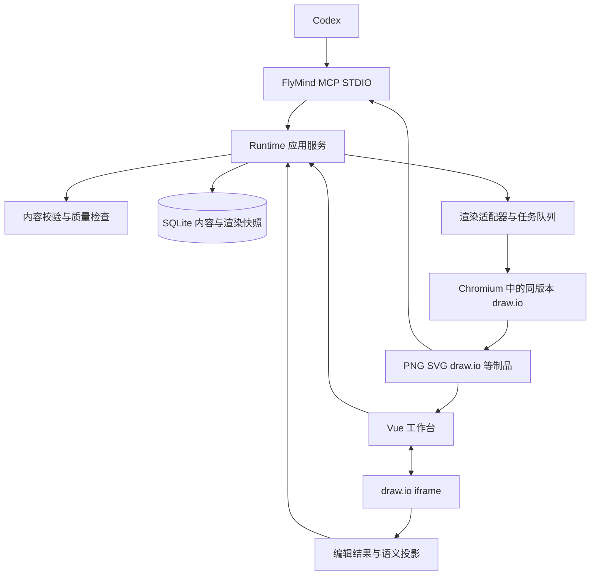

# FlyMind draw.io 技术设计

> 2026-10-24 R29：复用 NativeStudio/CloudStudio 与原创建、任务组、团队弹窗，增加 Welcome/Onboarding/AgentConnect 独立 UI。引导 localStorage key 使用 JSON 编码 userId/teamId，pending/completed/skipped 分离；创建/邀请依据实际 API 成功，交替编辑依据当前图形权威 activity 中不同已提交修订。Agent 安装消息仅携带固定 MCP URL 和校验过的团队/图形 ID，不携带标题指令或凭据；OAuth 仍由客户端执行，网站自确认不冒充连接检测。主题变量只影响工作台，不写入业务内容或 draw.io 节点样式。无数据库迁移，详见[本批验收](validation/onboarding-20261024.md)。

> 2026-10-23 R28：新增Flyway表app_flymind_account，复用sys_user.user_id以保留归属，密码/状态单独存储；兼容导入幂等且不自动开通纯后台账号。前台改密API经Node同源cookie/身份预检代理Java，错误原密码400不撤销会话，成功撤销前台会话/OAuth/设备授权并清cookie。后台要求真实启用角色；无tenant_id的两张关系表加入租户排除，实体过滤保留。文档为共享纯内容model+覆盖dialog，不改变画布协议。已本地验收，MySQL生产迁移与线上验收仍待Actions发布；[契约](cloud/CONTRACT.md)、[证据](validation/auth-documentation-20261023.md)。

> 2026-10-21 R26/R27：任务归属为内容对象之外的组织元数据，使用现有workspaceGroupId和新增create参数taskName；任务组与图形在同一SQLite事务落库，幂等回执与并发复用沿用现有服务，不在图内groups伪造文件夹。流程/泳道回流通过主方向/阶段及feedback语义识别，强制经过整体绘图区外侧通道，固定libavoid仍负责节点避障；只更新受影响边，普通文案编辑保留人工几何。本轮不改版本/不部署，证据见[本地验收](validation/task-groups-and-return-routes.md)。

> 2026-10-20 v1.1集成基线：按[版本计划](releases/V1_1_PLAN.md)合入冻结云端账号/团队/OAuth/协同核心与当前质量线。操作记录绑定权威身份和持久提交；目录导入复用已有结构验证/来源保留并增加批次去重与目标归档。发布同时保护MCP会话、协同未ACK编辑和不可变导出任务，服务器OS和现有服务待SSH只读核查。v1.1仍待实施/整体验收，不修改当前数据或取消本机安全边界。

> 2026-10-20 R22：采用固定 `/mcp` 远程接入，网关与绘图应用进程分离，稳定工具契约与动态权威guide配合；规则/schema/校验器同包发布，任务绑定不可变修订和引擎供应。云端首期SQLite仍为单活写入者，升级排空/重启/回滚由维护者完成；不以改客户端URL或静默上传本地图形完成更新。详细设计与实际缺口见[MCP持久更新方案](MCP_UPDATE_STRATEGY.md)，不能把设计误标为已实装。

> 2026-10-20 R21：内容层质量规则集中在 `core/drawing-quality.ts`，新旧MCP共享，native只映射结构化错误；在渲染前预检并在原生投影后复核。新建和显式重排由draw.io适配器执行分类型渲染策略、标题禁入区与标签避让，自动脑图方向写回渲染配置。流程备注保留为明确业务属性，不膨胀流程节点；不自动改业务类型/关系、截字或降低字号掩盖问题。人工保存与历史问题渐进修复仍保留。实际范围和限制见 [绘图质量批次](DRAWING_QUALITY_PLAN.md)。

> 2026-10-19 新增 R20：保留本机 Runtime 的安全边界，增加独立云入口；复用复制后的星辉 Java 身份/团队控制面，按可信团队隔离工作区，原业务服务与 draw.io 引擎继续复用。多人增量协议、MCP OAuth、授权本地入口及线上供应按 [cloud/PLAN.md](cloud/PLAN.md) 和 [cloud/CONTRACT.md](cloud/CONTRACT.md)分批实施。未经真实双端、MySQL/Redis、Linux 和公网验收，不宣称完整云端可用。

> 2026-10-18 发布增补 R19：npm 制品包含预编译服务和共享 drawing JS、构建后的原工作台、CLI、标准/guide 和第三方许可。bin 提供 mcp（默认）、setup、doctor、studio。CLI 显式选择当前原生模式，数据默认存 LOCALAPPDATA/FlyMind/data，凭据存 runtime，固定资源缓存独立于安装目录；FLYMIND_DATA_DIR、FLYMIND_PRIVATE_RUNTIME_DIR、FLYMIND_RESOURCES_DIR 可覆盖。先 setup 准备固定版本资源，再注册 MCP，避免首次下载阻塞客户端握手。STDIO stdout 仅协议，安装进度/诊断走 stderr。Registry 登记名 io.github.beidaomitu233/flymind，元数据不承载安装包；npm 发布后再登记。Windows 为本批验证平台。原源码入口兼容，既有用户根目录和模式不自动切换。

日期：2026-10-16。本文同时记录目标设计与已验收的原生pilot实现边界；D06已在隔离副本通过迁移/离线恢复，默认入口和用户数据尚未切换。需求见 [PRD](PRD.md)，任务与证据见 [实施计划](IMPLEMENTATION_PLAN.md)。

## 1 技术基线与复用边界

### 1.1 当前代码事实

| 部分 | 当前实现 | 迁移处理 |
|---|---|---|
| Web | Vue 3、Pinia、Vite；`src/drawing/ui/DiagramCanvas.vue` 自研画布 | 保留应用外壳，替换绘图区 |
| 内容模型 | `core/model.ts`、`layers.ts`，五种 kind；严格语义字段 | 保留语义契约与稳定 ID |
| 渲染 | `layout.ts`、`render.ts`、`routing.ts`；自研 SVG，Sharp 转 PNG | 迁移至 draw.io 文档与同引擎导出 |
| 存储 | `server/store.ts`，better-sqlite3、事务、WAL、历史与删除状态 | 保留数据库身份，增加迁移和渲染任务记录 |
| MCP | `server/mcp.ts`，STDIO，当前直接访问 DiagramStore | 保留工具名称，逐步改为共享应用服务客户端 |
| HTTP | `server/runtime.ts`，默认 5179；开发前端 5178 | 保留工作台入口与 API 前缀 |
| 工作区文档 | `schemaVersion:2`，content/rendering/createdAt/updatedAt | 显式升级为目标 v3，不覆盖旧快照 |
| draw.io 交换 | 已有 XML 导出，没有 XML 回读 | 不能等同于双向编辑能力 |

上级 PM Runtime 已有 `resources/drawio/vendor/`、iframe 的 init/load/save/export 通信以及另一套 SQLite。供应清单标记 draw.io 31.5.3。此版本只是可复用候选，资源内容、校验值和实际协议能力须在 D01/D02 核验。

上级 `apps/runtime/src/drawio.ts` 同时生成 XML 和自有 SVG/PNG；`store.ts` 接收原始 XML 时可不含 DSL。这两种做法不能原样作为新设计：目标需要统一渲染，并保证人工修改后的内容模型同步。

### 1.2 技术决定

- 采用 draw.io 完整编辑器，通过 iframe 嵌入；不抽取其底层图形库重做编辑器。
- 延续 Vue、Node、TypeScript、SQLite 与 FlyMind MCP，避免整体重写上层应用。
- 引擎静态资源自托管、固定版本；生产运行不依赖公共编辑器或公共导出服务。
- 浏览器编辑和后台渲染使用相同引擎资源、适配器、模板与字体。
- 使用公开嵌入协议；必要的引擎内部调用收敛在版本适配器内，经固定版本测试，不散落到业务代码。
- 引擎资源和 Chromium 的分发方式在 D01/D04 留证。本文不把下载或安装依赖视为已执行。

官方提供 iframe 嵌入及消息协议；公共托管嵌入使用 `embed.diagrams.net`。自托管实例需验证相同协议。[嵌入协议](https://www.drawio.com/docs/reference/embed-mode/)、[官方集成示例](https://github.com/jgraph/drawio-integration)

## 2 总体架构



Runtime 是目标状态中唯一的正式写入入口。MCP 和 Web 复用应用服务，避免各维护一套创建、同步和导出流程。SQLite 仍保留事务保护；“唯一入口”不代替数据库并发约束。

### 建议模块

| 目标模块 | 职责 | 禁止依赖 |
|---|---|---|
| `src/drawing/core/content/` | 语义模型、操作、引用检查、绘图质量 | DOM、Vue、draw.io 全局对象 |
| `src/drawing/engine/` | 引擎接口、投影、增量编译、模板策略 | 账号、API Key、工作区页面状态 |
| `src/drawing/engine/drawio/` | XML 读写、元数据、样式映射、固定版本能力适配 | 业务平台专属服务 |
| `src/drawing/ui/DrawioHost.vue` | iframe 生命周期、消息收发、视角与保存状态 | 数据库直写 |
| `server/application/` | 原子写入、冲突、幂等、权限边界、导出调度 | Vue |
| `server/render-worker/` | 浏览器池、字体、渲染与制品生成 | 用户会话中的可见页面 |
| `server/store.ts` | 数据库迁移、事务、历史、备份与删除 | 引擎 UI |
| `server/mcp.ts` | MCP schema、工具与资源、结果图片 | 独立业务写入实现 |

路径为目标建议，实际迁移分批进行，不能仅移动旧文件就宣称解耦完成。

## 3 两层模型及版本

### 3.1 内容层保持兼容

继续采用内容 `schemaVersion:1`，kind 为 `swimlane/flowchart/architecture/mindmap/dataflow`。

| 字段 | 业务含义 |
|---|---|
| id/title/kind | 稳定身份、标题、图形种类 |
| nodes | id、label、kind；可选 laneId/phaseId/groupId/parentId/color/description/items/badge |
| edges | id、source、target、label、kind=flow/feedback |
| lanes/phases | 角色和真实业务阶段，数组给出容器顺序 |
| groups | 业务分层及可选语义颜色 |

节点数组不代表流程先后；流程关系通过 edges 表达。思维导图保留现有同级数组顺序和 parentId 规则，其父子连接由适配器派生，不产生另一份可冲突的业务父子关系。

普通内容接口严格拒绝 x/y、width/height、order/ranks、font、shape、points、线型等字段。`description` 是业务说明，不是布局提示。语义颜色可省略，不要求 AI 提供配色。

`note` 继续作为兼容的业务批注节点，渲染为浮动文字，不参与主流程排序。纯视觉装饰无需进入 content。

### 3.2 目标工作区格式 v3

```ts
interface ProjectV3 {
  schemaVersion: 3;
  content: DiagramContent; // schemaVersion: 1
  rendering: {
    profile: { id: string; version: string };
    preferences: RenderingPreferences;
    engine: {
      name: 'drawio';
      version: string;
      adapterVersion: string;
      xml: string;
      contentHash: string;
    };
  };
  createdAt: number;
  updatedAt: number;
}
```

上述类型为目标协议，不是当前可直接导入的格式。revision、workspaceGroupId、同步状态和渲染任务状态放在存储记录元数据中，不进入 content。

D07 导入扩展使用独立联合分支 `NativeDrawingProject = DrawingProjectV3 | NativeCanvasProjectV3`。业务分支继续严格验证上面的两层结构；仅画布分支为 `{schemaVersion:3, mode:'canvas-only', id, title, rendering:{engine:{name:'drawio',version,adapterVersion,xml,xmlHash}}, createdAt,updatedAt}`，没有 content、kind、profile、contentHash 或业务质量分。`xmlHash` 绑定保存原 XML，不能冒充业务摘要。该分支共用记录身份、CAS、历史、组织和删除规则，尚在 D07 实现/验收中。

无元数据的单页原生稿才能进入仅画布模式；残缺 FlyMind 映射明确 invalid，不降级掩盖损坏。显式属性映射从原生可见元素建立类型/归属/父子/连接并严格投影，验证后新修订转换业务模式，保留原稿和几何。导入预览在用户确认前不落库，确认绑定原始字节/请求身份/目标组，未确认的网络结果沿原请求精确重试。

`preferences` 存主题、方向、节点标准、线路标准、显式覆盖的策略。几何、折点、文字位置、组合和装饰的最终事实存于 engine.xml。旧 rendering.positions 等在迁移时一次转换，不能与 XML 长期双写并各自生效。

渲染优先级：人工单元素覆盖 > 显式渲染标准 > 可选语义颜色 > 模板默认。模板版本更新不自动改已保存图形；用户选择应用新模板时生成新修订。

`contentHash` 由规范化 content 计算，防止把旧内容和新 XML 拼成正式文档。哈希与元数据不能代替投影校验；正式提交必须重新解析 XML 并验证一致性。

### 3.3 身份与元数据

业务 ID 与引擎 cell ID 分开。使用 draw.io 支持的自定义对象属性承载以下适配器约定，字段并非 draw.io 自带业务标准：

| 属性 | 用途 |
|---|---|
| fmType | node/edge/lane/phase/layer/annotation/decoration |
| fmId | 内容对象的稳定 ID |
| fmKind | 节点或业务容器类型 |
| fmLaneId/fmPhaseId/fmGroupId | 业务归属，适用于二维泳道等无法只靠 parent 表达的结构 |
| fmRole | 主形状、标题、模块条目、边标签等视觉子元素用途 |
| fmAdapter | 元数据协议版本 |
| fmIndex | 内容数组的序列化次序，用于独立 XML 回读；不是流程排序或坐标 |

一个业务模块可对应多个视觉元素，但只能有一个主绑定；标题、条目、图标作为受控子元素。映射索引从 XML 计算，可缓存，不再维护独立可修改的主映射表。根对象可记录文档/模板标识，业务正文不复制成不可见的第二份 content。

D02 固定版本实测会重写部分 mxGraphModel 属性，文档身份与模板标识同时放在可见标题对象上，以该绑定作为回读依据。主绑定携带局部 fmIndex，避免 XML 按容器分组后改变内容数组顺序；流程先后仍只由业务连接表达。

复制带元数据的元素时会复制业务 ID，必须识别副本、生成新业务 ID、重映射内部边；不能因为 fmId 相同而覆盖原节点。重名 cell、孤立引用、重复主绑定均阻止正式保存并保留恢复草稿。

## 4 引擎边界与布局

### 4.1 适配器契约

```ts
interface DiagramEngine {
  compile(content: DiagramContent, options: CompileOptions): Promise<EngineDocument>;
  project(xml: string, base: ProjectV3): Promise<ProjectionResult>;
  applyPatch(base: ProjectV3, operations: ContentOperation[]): Promise<EngineDocument>;
  configure(base: ProjectV3, changes: RenderingChange): Promise<EngineDocument>;
  export(snapshot: ProjectV3, options: ExportOptions): Promise<ArtifactSet>;
}
```

compile 负责首次生成及显式重排；project 负责人工编辑回写；applyPatch 负责保留人工编辑的增量编译。接口传入的 base 总是已提交修订快照，不能来自另一正在变化的页面状态。

### 4.2 各类型布局策略

| 图形 | 适配器提供的业务策略 | 引擎/布局组件承担 |
|---|---|---|
| 流程图 | 确定起止、主方向、判断和反馈边 | 节点尺寸、层次排列、端口及正交路由 |
| 泳道图 | 角色/阶段区域、依赖推进、独立分支和反馈 | 原生容器、区域内布局、文字测量、线路与编辑 |
| 架构图 | 层序、模块归层和必要依赖 | 容器、网格/层次布局、模块卡片和连接 |
| 思维导图 | 根、父子及同级顺序 | 树布局、分支、文字和连接 |
| 数据流图 | 输入/处理/输出与反馈关系 | 分层布局、卡片、汇聚带及路由 |

使用引擎已有布局或固定版本的 ELK 适配，保留少量业务编排规则，不继续扩展自研通用路由器和碰撞算法。首次布局在后台可重复运行，Web 打开保存结果，无需再排一次。

二维泳道重点验证 draw.io 原生跨职能容器/表格表达。角色列与阶段行的交叉区域具有显式映射，不能尝试让一个节点同时拥有两个 XML parent。若固定版本原生能力不足，先调整模板或通过业务属性显式设置归属，记录限制；不默认重建一套阶段拖拽引擎。

反馈边不参与主流程层级推进；真实前置边不能为压缩高度改成反馈。独立分支可并排，汇合必须在必需前置之后。人工位置优先；普通文字变化只扩展必要范围，不能触发整图重排。

### 4.3 配色、文字与线路

模板管理字体、色板、线宽、圆角和留白。保留 blue/indigo/forest 等既有主题的映射。中文字体使用可分发且已核实许可的本地字体，等待字体加载完成才测量与导出。

业务标题、卡片正文和浮动文字分别设定样式。浮动文字不占流程行，也不推动泳道阶段。边标签保持业务边关联，但位置独立可调；用户删除标签对应清空 edge.label，条件缺失由质量规则报告，线路保留。

默认正交线路，允许直线等显式渲染选择。路由、线段拖动和端点操作交给引擎；不能通过重新生成整条线抹掉人工折点。官方新版本 MCP 提供 ELK 和 libavoid，可作为研究参考，不能据此假设本地 31.5.3 已具备相同 API。[官方 MCP](https://github.com/jgraph/drawio-mcp)

## 5 嵌入协议与前端生命周期

### 5.1 启动与通信

自托管地址建议为 `/drawio/index.html?embed=1&proto=json`。是否启用 configure、菜单参数及简洁模式，以固定版本验证结果为准。

1. 校验资源就绪；创建 iframe，绑定当前 diagramId、revision 和会话 generation。
2. 若启用 configure 握手，收到事件后发送配置，再等待 init。
3. 收到 init，发送 load，携带已提交 XML、标题及 autosave。
4. 收到 save/autosave，提取 XML，进入保存队列；收到 export，匹配当前待处理请求。
5. 切换图形时结束旧会话，迟到事件不得写入新图形。

消息必须同时校验 event.source 和精确 event.origin；postMessage 使用精确 targetOrigin。消息结构、大小、类型和会话均校验，禁止任意函数执行。请求关联信息使用固定版本能回传的 message 字段；若不支持则同类请求串行处理。

以上事件和动作依据官方 JSON 嵌入协议，具体配置和兼容结果登记在供应记录。[协议文档](https://www.drawio.com/docs/reference/embed-mode/)

界面外观独立于文档渲染主题：NativeStudio同步读取本机`flymind-studio-appearance`，根CSS tokens与`appearance:light|dark`传入常驻Viewport/Host。Host仅在同源文档注入固定ID的UI样式并切根属性，覆盖原生工具条、菜单和弹层；不改变iframe key/src或发送load，不进入内容/渲染保存API。固定`dark=0`避免原生图形暗色反转，图元和制品保留原稿颜色。用户追加要求后，dark工作背景及无分页根SVG的CSS背景为#171717，仅以soft-light混合原生透明网格，不改网格图像/位置/尺寸；浅色恢复原背景。真实分页保留纸张本体原色。具体实页证据见[外观核验](validation/native-appearance-ui.md)。

### 5.2 自动保存与视角

首次启动时，Host的iframe挂载首帧使用visibility:hidden、inert及aria-hidden，保留布局尺寸以供原生引擎正常初始化；可信load握手完成并经过双requestAnimationFrame后显示。首次启动失败提供小型重载入口，重试先清src再创建新iframe/controller。

切换已有图形时，显示目标与编辑会话分离：点击同步更新列表选中、标题、图形类型和深链接，并立即用常驻浅色加载层覆盖固定画布区域。先经 nextTick 和双 requestAnimationFrame，让点击反馈实际绘制，再捕获保存原图、核对离开条件和准备目标。加载层内的16px转圈及“加载中”在140ms后出现，无背景淡入淡出或最短等待；标题栏、工具栏、已展开属性栏保持尺寸。不会把原图显示在新标题下，也不展示原生启动页。

DrawioViewport最多保留当前与候选两个独立Host，各自source/controller/session隔离。候选真实ready后，最终generation校验与激活之间没有异步间隙；原会话异步关闭，目标Host完成显示确认后才解除加载层。连续点击用单个待打开目标和generation取最后一次请求，丢弃过时候选；失败移除候选并恢复仍可用的原会话、选中与URL。候选及旧会话迟到保存事件不得写入当前图。wrapper和工具栏始终挂载，普通自动保存不创建候选、不重载画布。详见[切图封装与验收](validation/native-viewport.md)。此项改善过渡显示，不宣称已消除原生初始化耗时。

建议防抖 800ms，最长 3 秒触发保存；这些数值为待验证配置。输入法组合输入、连续拖动过程避免中途拆成多次提交；以引擎稳定的模型变更结果为准。

每个编辑会话只有一个提交请求在途。保存 A 期间发生修改 B，保留 B，A 成功后使用返回的新 revision 提交最新 B；不能因 A 的响应把 B 清除。请求重复使用幂等键。

保存成功只更新 revision、状态和哈希基线，不重新发送 load、不 fit、不重建 iframe。界面视口保存在会话状态，与业务修订分开。普通选择、平移和缩放不更新业务修改时间。

2026-10-17 原UI适配：FlyMind继续提供原侧栏、新建对话框、标题、工具栏、业务属性和格式导出菜单。画布采用固定官方 `ui=min&sidebar=0&format=0`，原生形状库按需打开，避免两套固定菜单和侧栏。五类创建/编辑/导出使用同一NativeClient、NativeSaveSession及SQLite，不另建产品数据源。

显式业务属性提交与普通自动保存区分：先提交当前文字并flush，再以最新revision调用manual content-patch；Host读取公开export的scale/translate和只读DOM滚动位置，公开load返回XML并恢复同一模型视口；同一SaveSession采纳新修订，不重建iframe。固定31.5.3公开merge不进入本地撤销栈，因此该显式提交清空此前画布Undo历史，避免撤销越过已提交属性；之后的新画布操作仍可撤销。选区不保证保留，普通保存/ack仍绝不load。读取iframe滚动元素用存在/数值检查，不能使用父窗口HTMLElement的instanceof判断。

收到外部新修订且本地干净时，可以加载新文档并恢复视角和可匹配选区；外部更新会重建原生撤销基线，需记录来源。存在本地未保存修改时进入冲突状态，不自动加载。跨用户或 AI 的合并不冒充本地可撤销操作。

### 5.3 恢复草稿

IndexedDB 按数据根标识、diagramId、baseRevision、会话 ID 保存未同步 XML，不作为列表数据源。恢复前核对远端存活状态与修订；删除图形的草稿只能另存新 ID，不能恢复原 ID。

无法投影或引用损坏的 XML 放入独立恢复草稿记录，保留原修订，不提交失配的双层正式文档。断网、磁盘满和配额不足分别提示并允许下载恢复文件。

## 6 人工编辑到内容的投影

投影在 Runtime 再执行一次，前端预检查仅用于及时反馈。依据 XML 元数据、主形状、关联端点及受控子元素还原内容；不通过文字相似度猜业务身份。

| 编辑 | 内容处理 | 渲染处理 |
|---|---|---|
| 改业务节点标题/正文 | 更新相应字段，HTML 转为受控纯文本 | 保留原有几何与非相关样式 |
| 拖动/缩放/改色/组合 | 内容不变；语义归属变更另判 | 保存原生 XML |
| 从业务图形库新增节点 | 生成业务 ID，校验类型和归属 | 保留新形状、位置与样式 |
| 从普通库添加未知形状/文字 | 默认仅画布元素，不加入业务流程 | 原样保留；可显式转换为业务元素 |
| 删除业务节点 | 删除相应内容及关联业务边；脑图按明确子树策略处理 | 清理相关主形状及受控子元素 |
| 新增或重连业务边 | 同步 source/target；类型和条件校验 | 保存原生线路 |
| 连接装饰与业务元素 | 作为画布连接保留，提示可转换 | 不误造业务依赖 |
| 调整角色/阶段/分层 | 显式业务归属同步 | 节点落点与容器边界一致 |
| 脑图父子线重连 | 修改 parentId，校验单根、无循环 | 更新派生树边及原生布局 |
| 修改阶段栏文字/容器标题 | 同步阶段/角色/分层 label | 保留尺寸和边界 |

角色/阶段只在明确移入区域且归属可唯一判定时随拖动改变。仅缩放容器、边界压过节点、临界线落点不自动推断业务转移；保持原归属或要求在业务属性确认。每次保存检查实际区域与声明归属是否矛盾。

复制业务子图时保留内部业务边、条件与渲染，生成新节点和边 ID；外部引用不隐式复制。跨图粘贴缺少目标角色/阶段时进入待归属草稿，不能凭空创建同名角色。图形库的业务类型标记需可见可选，不能只靠隐藏元数据让用户无法理解。

schema 错误、悬空边、重复绑定、脑图循环阻止正式保存；业务质量不足但结构合法的人工图可以保存并标记质量问题。保持既有人工草稿能力。

脑图删除带后代主题按整个分支处理，并在交互中确认；保留后代需先重新指定父主题。不能提交删除根后无根的正式脑图。无元数据文档转换业务模式时，先显式设定节点类型、容器/父子归属及业务连接，验证完整后再转换；原始原生稿保留。

固定 31.5.3 的普通 Delete 可能只断开节点关联线而保留悬空画布线。此时不能在服务器悄悄删线后宣称已保存：保留错误草稿并定位 `NATIVE_DELETE_INCOMPLETE`，提示撤销后使用原生 Ctrl+Delete（包括关联线）。没有关联线的普通删除不受影响。脑图“删除当前分支”经用户确认、公开 JSON selection 校验单个非根主题后，调用原生 `selectDescendants` → `deleteAll`，不通过服务器级联删除，也不 reload 整图。业务交叉边设为不参与父子遍历，但删除分支时其关联线仍由原生一起清除；撤销恢复后再保存形成新修订。该规则及原生恢复链路分别验证，不以 normalize 后的 XML 掩盖现场残件。

`description/items/badge` 等无法仅靠主形状完整表达的字段，通过受控子元素或业务属性修改，原样保留未编辑字段。不能每次投影都从可见标题重新构造并丢弃其余内容。

## 7 AI 增量修改与渲染调整

### 7.1 内容 patch

1. 获取最新 revision、同步状态、content 和质量报告。
2. 应用内容 operations，执行引用和质量检查、锁定约束。
3. 从原生文档定位稳定业务绑定，只修改受影响节点/边/容器。
4. 文案修改保留位置和手动尺寸，必要时局部扩展；新增节点在受影响区域布局，删除清理关联对象；未涉及的几何、样式、装饰保持不变。
5. 移动归属或改变结构影响区域时返回调整摘要。无法局部安全调整则返回明确问题，不能静默全图重排。
6. 投影新 XML 校验与新内容一致，事务以 expectedRevision 提交，再调度该修订导出。

锁定业务节点的内容和几何修改遵守现有拒绝规则；用户明确解锁后才能修改。更新无实际差异时返回原修订，不改 updatedAt。

### 7.2 渲染配置

保留 `get_rendering_config/configure_rendering` 的用途，AI 普通绘图无需调用。目标提供模板和可理解的渲染标准，原生 XML 通过完整工作区导出或专用读取入口获取，不塞进普通内容响应。

现有 configure_rendering 是完整替换。兼容适配只替换可见标准/覆盖字段，不删除 engine.xml 中未知装饰和人工编辑；旧字段映射不支持时返回 `UNSUPPORTED_RENDERING_OPTION` 并给出新入口，不静默忽略。目标新选项由显式 API 能力版本声明，不能把 v3 JSON 直接传给旧 schema。

“自动布局”是单独显式操作。先计算将调整的范围，默认保留锁定元素；全图重排需说明会重置哪些手动几何。生成新修订并保留历史，不能混入自动保存流程。

2026-10-18 已开放五型 `configureDrawio(base,{relayout:true,orientation?})`，沿用原 rendering CAS/幂等接口；公开范围仅显式重排与方向，其他未完配置明确拒绝。工作台先捕获保存，再提交配置、显式应用XML、adopt已提交修订；不确定结果沿用同requestId重试。应用内确认可取消，方向选择先恢复实际已提交值。人工组合/锁定元素受保护，不能安全全排时拒绝且不拆组；显式重排保留业务内容、配色、尺寸、分层和父子关系，重置位置与线路折点。普通保存不重排；显式应用仍沿用当前Host的load/撤销基线限制。

脑图按方向固定父子出入端口，同级对齐；固定libavoid对同一固定父端口批次只返回首条路线的情况，改为父子线逐条调用同一供应路由器，保留全部节点障碍，统一正交主干。其他业务边继续批路由。Host使用固定供应已支持的 `tooltips=0` 关闭内部绑定字段提示，正常连接控点保留；原生group/ungroup只扩展两项精确公开action白名单。见[布局核验](validation/native-layout.md)及[工作台补齐核验](validation/native-editing-parity.md)。

### 7.3 G1 已验收的局部路由实现边界

首次泳道编译使用固定draw.io31.5.3供应内的pure-JS libavoid和官方 `AvoidRouting.computeRoutes`，只计算边路径，不移动节点。既有XML patch只为新增/端点ID改变边重新求解；清除这些边的过期端口、折点和标签偏移，保留文字、paint和锁，其他cell保持不变。全部当前业务框作为障碍，旧路线及标签只读占位。新标签按文本范围、行高、节点和路线留空槽，无安全位置返回明确错误，不向内容层要求坐标。

Node供应校验与装载在独立延迟模块；共享Vue投影没有顶层Node fs依赖。固定资源不改写，不访问CDN、不新增包；供应hash、LGPL来源及V04分发待核见 [G1引擎报告](validation/native-g1-editing.md)。原生自环保留原生loopStyle并验证真实SVG。三样本验收不承诺任意人工曲线占位估算或全图最优交叉；修改归属/尺寸后的incident边在D07继续验证，普通保存不触发全图重排。

## 8 Runtime、MCP 与调用契约

### 8.1 后台生命周期

目标 MCP 启动流程：读取配置和数据目录 → 查找对应 Runtime → 验证实例、版本、数据根和能力 → 不存在时启动隐藏后台进程 → 等待健康就绪 → 接受绘图请求。

进程启动采用单实例锁及就绪握手，避免多个 MCP 客户端同时启动多个服务。端口被其他程序占用或版本不兼容时明确失败，不能连错工作区。退出一个 MCP 不立即杀死仍被 Web/其他客户端使用的 Runtime；空闲退出策略待 D05 实测，开发期间默认常驻且可显式停止。

STDIO stdout 只写 MCP 协议，诊断走 stderr。MCP 和 Runtime 使用本机随机会话凭据握手，配置记录限制本机访问。引擎 worker 与客户端生命周期分离。

D05 已验收的实现接口（指定 pilot 范围，见验收台账）：`ensureNativeRuntime` 返回本机 baseURL、固定 dataRootId/instanceId、能力与认证 fetch；客户端 close 只解除连接，不关闭共享后台。启动前验证显式隔离根，原子单实例占用及本机端口绑定均在 SQLite 初始化之前；活实例复用，错根/版本/外来端口拒绝，失效锁按 owner/实例复核恢复，不杀其他进程。

同一 MCP 进程发生网络失败或明确 401 时，仅使对应旧连接缓存失效并返回需要原 requestId/payload 重试的错误，不自动重放结果不确定的写入。下一次请求重新 ensure，但必须保持首次成功绑定的 dataRootId；同库新实例可恢复，同路径换库拒绝。迟到旧连接失败不能清除已建立的新连接，业务 CAS/质量错误不触发重绑。启动失败还必须等待本次自有子进程退出并收口 worker/renderer，避免调用方清理临时目录时仍有日志/浏览器活动。

会话凭据保存在当前 OS 用户私有目录，测试注入独立临时目录，不实改用户配置。公开 health 不含凭据和完整路径；连接端以 nonce/HMAC 确认真正实例后才发送 Bearer。pilot 数据 API 与下载接受 Bearer 或实例专属 HttpOnly/SameSite cookie；Web 通过严格本机 Host/Origin 的会话 bootstrap 获取 cookie。已有保存客户端的工作区身份仍不可随 health 自动改绑。默认非 pilot 分支保持现状，正式统一切换在 G2。

显式停止使用 pilot 专属、仅 Bearer 的 `POST /studio-api/runtime/shutdown`，还需匹配 instanceId 和工作区身份；仅 cookie 不足以授权停止。`requestNativeRuntimeShutdown(connection)` 专门供明确停止及自有临时实例的探针清理，客户端 close/MCP 退出绝不自动调用，不新增 MCP 停机工具。响应完成后依次关闭 worker、Chromium、HTTP 和本实例锁/凭据。保留父子私有 IPC；此处不是未认证停机端点，也不终止其他实例。

2026-10-18 Windows静默导出修复：固定headless-shell属于控制台程序，`headless`不足以隐藏控制台。Windows渲染器通过自有`spawn(windowsHide:true,shell:false)`及私有CDP管道连接固定Playwright公开API；不开放调试端口、不修改供应或依赖。关闭有界等待，只清理所属进程树及专用临时profile；异常强杀同样隐藏窗口。具体核验与偶发超时记录见[静默导出核验](validation/native-silent-export.md)。

### 8.2 现有 MCP 工具与目标兼容

| 工具 | 目标行为 |
|---|---|
| get_drawing_guide | 返回技术规则、内容标准、类型模板及能力版本 |
| validate_diagram | 结构和质量检查，不保存；兼容现有输出时通过真实引擎测量返回尺寸，不能伪造；可选尺寸需显式升级能力/schema |
| list_diagrams/get_diagram | 列表元数据、最新内容及 revision；增加同步/质量/导出状态；preview 可取图片 |
| create_diagram | 纯 content、稳定 requestId，必须有 workspaceGroupId 或 taskName；同引擎生成，分组复用/创建与落图同事务后交付，图内groups不表示工作区归属 |
| patch_diagram/update_diagram | expectedRevision 必填；增量修改保留原生文档；完整替换仍保留未涉及渲染 |
| get_rendering_config/configure_rendering | 独立渲染标准及显式视觉调整，带版本保护 |
| export_diagram | 对指定已提交快照导出；兼容不传 revision 时选择当前版本 |
| list/create/rename/delete_workspace_group | 工作区分组 CRUD，不改变图形内容 |
| move_diagram_to_group | 带预期原分组，避免覆盖并发移动 |
| list_deleted_diagrams/restore_diagram/permanently_delete_diagram | 最新删除令牌校验，沿用显式恢复与永久删除约束 |

精确输入输出由 `server/contracts.ts` 和真实 tools/list 决定。新增 requestId、指定 revision、能力字段等在 D05/D09 更新 schema 和 guide，本文不声称旧客户端已经支持。

D05 AI 请求准入已与人工结构草稿分开：原生 AI create/patch/update 进入共享应用服务执行质量规则，人工 editor-save 仍可保存结构合法但质量待完善的图形。AI 完整 update 先计算语义差异再使用原生 patch，避免重排未涉及的人工布局。AI 与人工请求的 operation/hash 作用域分开，editIntent 进入幂等请求哈希，不能重放人工回执绕过 AI 质量准入。

D05 暂不具备完整安全视觉 patch 时，`configure_rendering` 明确返回 `NATIVE_RENDERING_EDIT_UNSUPPORTED`，能力与 guide 如实说明，不能仅改元数据或套用旧位置 schema 冒充原生图形已更新。五类模板与全部渲染配置能力统一在 D07 补齐并验收。

成功的创建/修改/导出返回：diagramId、revision、createdAt、updatedAt、workspaceGroupId、editorUrl、quality、exportedAt、files/urls/resources、实际图片尺寸，并附 PNG image 内容块。files 是客户端所在机器可用的绝对路径，远程路径语义不在一期范围。

资源保留 `flymind://guide`、`flymind://drawing-standard`、图形读取与按修订/导出 ID 的制品 URI。新规则、示例及 skill 与 schema 一起更新；不要求 AI 每次自行读仓库代码。

D05 真实 STDIO 已发现固定完整 CJK 字体 SVG 约 22 MB，超过已安装 SDK 的默认 10 MiB ReadBuffer。实施采用固定 8 MiB 的最终 JSON UTF-8 内联预算，不增加用户配置：图片预览与资源内容发送前检查，超大资源返回可控 `MCP_RESOURCE_TOO_LARGE`，保持连接可用；过大 PNG 预览单独标记 `previewStatus=too_large/MCP_PREVIEW_TOO_LARGE`，不把已成功导出标为失败。所有文件/下载仍保留，资源链接带 size，只有预算内文件附可内联资源链接，并返回各格式 resourceLimits。完整 SVG 通过经验证的本机 files 或认证下载交付，不宣称默认 SDK 已能读取 22 MB 资源；字体子集化另作后续体积优化，不在此改变已验收字库。

以下示例展示保持兼容的内容输入，不含拟新增的 requestId 等字段。图形 ID 为示例，新建时需确保唯一。

```json
{
  "content": {
    "schemaVersion": 1,
    "id": "review-demo",
    "title": "需求评审流程",
    "kind": "swimlane",
    "lanes": [{"id":"pm","label":"产品经理"},{"id":"reviewer","label":"评审人"}],
    "phases": [{"id":"draft","label":"需求准备"},{"id":"review","label":"评审确认"}],
    "nodes": [
      {"id":"submit","kind":"start","label":"提交需求","laneId":"pm","phaseId":"draft"},
      {"id":"judge","kind":"decision","label":"是否通过？","laneId":"reviewer","phaseId":"review"},
      {"id":"revise","kind":"task","label":"修改需求","laneId":"pm","phaseId":"review"},
      {"id":"done","kind":"end","label":"确认范围","laneId":"reviewer","phaseId":"review"}
    ],
    "edges": [
      {"id":"e1","source":"submit","target":"judge"},
      {"id":"e2","source":"judge","target":"done","label":"通过"},
      {"id":"e3","source":"judge","target":"revise","label":"不通过"},
      {"id":"e4","source":"revise","target":"judge","kind":"feedback"}
    ],
    "groups": []
  }
}
```

修改示例：先读取该图；若读取结果 revision 为 7，再提交以下 patch。示例修订不能照抄到其他会话。

```json
{
  "id":"review-demo",
  "expectedRevision":7,
  "operations":[
    {"op":"update_node","id":"revise","changes":{"label":"补充验收标准"}}
  ]
}
```

该操作修改原步骤，渲染适配器保留其他节点、线路和人工布局。复杂内容示例继续维护在 examples 中，不在文档里复制完整 PBS 数据。

### 8.3 目标 HTTP 扩展

继续使用 `/studio-api`，保留现有图形、分组、回收站与备份路由。以下为新增设计，待实现：

| 方法与路径 | 用途 |
|---|---|
| GET /studio-api/capabilities | 模型、适配器、引擎及接口能力版本 |
| POST /studio-api/diagrams/:id/editor-save | expectedRevision、requestId、XML；服务端投影后保存 |
| POST /studio-api/diagrams/:id/content-patch | expectedRevision、requestId、operations、editIntent |
| POST /studio-api/diagrams/:id/exports | 指定 revision 和格式，返回任务/导出记录 |
| GET /studio-api/render-jobs/:jobId | pending/running/succeeded/failed 与制品或错误 |
| GET /studio-api/diagrams/:id/revisions | 列出历史，不预设现有 UI 已支持 |
| POST /studio-api/diagrams/:id/revisions/:revision/restore | expectedRevision；复制历史为新修订 |
| POST /studio-api/workspace/restore/validate | 校验选定备份、版本及清单，返回待确认恢复范围 |
| POST /studio-api/workspace/restore | 校验通过后显式确认，保护当前库并切换，恢复期间暂停业务写入 |

现有 PUT 文档保存必须接入同一校验服务，禁止成为绕过投影的后门。Web 使用共享服务，MCP 调用不依赖页面是否存在。

### 8.4 错误约定

| code | 含义及恢复 |
|---|---|
| VALIDATION_FAILED / QUALITY_FAILED | 修复定位到节点/边的问题 |
| CONFLICT | 返回 currentRevision，重新读取并理解差异 |
| DELETED / NOT_FOUND | 禁止盲目重建原 ID；明确恢复或新建副本 |
| SYNC_REQUIRED / UNSUPPORTED_SEMANTIC_EDIT | 映射缺失或不支持的业务变更；处理映射/归属后重试 |
| RUNTIME_UNAVAILABLE / ENGINE_UNAVAILABLE | 服务或资源未就绪，返回诊断步骤 |
| RENDER_FAILED / RENDER_TIMEOUT | 文档是否已保存、ID、revision、jobId；按同一修订重试导出 |
| STORAGE_BUSY / STORAGE_FULL | 保留草稿，重试或释放磁盘 |
| IDEMPOTENCY_KEY_REUSED | 同一键出现不同请求，禁止执行 |

MCP 执行错误使用 isError 及结构化错误文本；字段 schema 错误由 SDK 处理。失败绝不返回旧图冒充新修订制品。

## 9 保存事务、修订与幂等

### 9.1 正式保存

重型 XML 投影、增量编译和校验在事务外执行；事务内再次检查 revision、删除状态及同步基线。短事务一次写入：当前文档、不可变历史快照、质量/同步元数据、幂等结果、待导出任务。

建议扩展现有数据库：

| 数据 | 处理 |
|---|---|
| diagrams / diagram_versions | 保留身份和历史，document 支持 v2/v3；新增独立同步/质量元数据 |
| workspace_groups / diagram_tombstones | 保留，不因迁移重建 |
| render_jobs | jobId、diagramId、revision、snapshotHash、参数、状态、租约、尝试次数、错误 |
| artifact_exports | exportId、revision、engine/profile/font 标识、exportedAt、文件校验和及清单 |
| mutation_requests | 客户端作用域、requestId、请求哈希、提交结果引用 |
| recovery_drafts | baseRevision、会话、原 XML、失败原因；不混入活动内容 |
| schema_migrations | 数据库迁移版本、时间、结果 |

使用已有 WAL、FULL 同步和外键约束。写操作带比较条件；数据库内校验成功才能确认保存。删除标记及修订冲突在后台任务完成时也需再核对，不能让迟到结果恢复已删除图形。

数据库约束：历史以 `(diagram_id, revision)` 唯一；幂等以 `(client_scope, request_id)` 唯一；任务和导出各有独立主键；任务引用的修订必须存在。领取任务按状态/可重试时间索引，租约到期才重新领取。删除与任务取消在同一事务登记，已删除图形的制品不再通过活动下载接口暴露。具体 ALTER/CREATE 脚本在 D06 按实际 schema 递增，禁止用重建整库替代迁移。

### 9.2 幂等规则

创建、编辑保存及 patch 支持客户端作用域内 requestId。相同键、相同规范化请求返回原提交及任务；不同请求使用相同键拒绝。网络重试必须沿用原键，新的业务操作使用新键。

自动导出任务可按快照哈希复用计算结果。用户显式导出每次建立新 exportId 和 exportedAt，即使复用渲染缓存，也生成独立交付副本。

### 9.3 保存和导出的状态分离

文档保存成功后，内容与 XML 已一致；图片可处于 pending/running。创建/修改 MCP 默认等待该快照完成导出，再返回成功图片。等待超时则返回已保存身份和任务，不能回滚已确认文档或再次创建重复图形。

后台以 jobId 领取任务并持有租约，崩溃后可安全重试。任务读取不可变修订快照，不读取动态 latest。修订被后续编辑替换后，旧任务可作为历史导出完成，但绝不更新新修订的预览引用。

## 10 同引擎后台导出

### 10.1 选择与流程

D04 已通过指定范围验收：项目固定 `playwright-core 1.62.1` 及对应 Chromium headless shell revision 1234；资源在本项目 `resources/` 内安装/校验，不以父 PM 目录或机器 Chrome 作为正式供应。官方 draw.io 31.5.3 WAR 的固定 SHA-256、逐文件补证与字体来源见 [供应准备](validation/drawio-runtime-supply.md)。资源安装使用固定 `fflate 0.8.2`，不自行实现通用 ZIP 解码器。应用版本仍为 0.6.0。

新模板、原生业务库、Host 与 worker 使用同一固定 Noto Sans CJK SC 2.004 字体配置。历史 native XML 的 Microsoft YaHei 字体名称可通过公开 fontCss 映射到同一 Noto 文件，保留源 XML/人工几何，同时在导出运行元数据和 warnings 中明确字体替代；不能称仍按系统原字体绘制。未供应的自定义字体明确拒绝，不能静默 fallback 后声称 SVG 可移植。普通装饰的默认字体也须使用同一策略。

原生 SVG 关闭重复字体内嵌后，仅在资源封装阶段将已供应的 Noto/Microsoft YaHei/Helvetica/Arial 引用规范为同一字体，并内嵌单份固定 SHA OTF。源 XML 不改；文字、几何、颜色、非字体 CSS 保持原样且签名复查。PNG 仍来自原生导出。此举避免四个等价别名重复携带同一字库；不是另一套图形渲染。未知族拒绝。证据与约 22 MB 完整字库体积限制见 [渲染核验](validation/drawio-renderer.md)。

后台 renderer 的职责只到原生 PNG/SVG 字节及实际尺寸/比例/运行元数据，不负责写业务库或发布文件。不可变导出任务、租约及发布由导出应用服务负责。任务请求沿用工作区身份 header，客户端不能跟随新的 health 身份自动改绑；入库事务重新校验身份。

目标使用 Node 管理的 Chromium worker，加载本机固定 draw.io 资源及专用宿主页，通过标准协议加载 XML 和导出 PNG/SVG。浏览器自动化建议使用 Playwright；引入时锁定依赖与浏览器版本。

宿主页复用编辑适配器和字体配置，关闭动画及自动外联，等待 init、文档加载、字体/图片解码及布局稳定，再执行导出。不得继续用独立自研 SVG 作为主要输出，否则两套文字测量与路由仍会失配。

worker 默认串行处理一个任务，使用可复用浏览器和隔离页面。不同任务的字体、页面状态及请求关联隔离；超时重建页面，连续失败重启浏览器。初期并发为 1，测量后再调整。

### 10.2 输出与时间

D04 API 的固定格式名沿用 `png/svg/drawio/json/project.json`。`POST /native/diagrams/:id/exports` 以 expectedRevision/requestId 绑定快照，后台修改图形不改变既有任务输入；GET 任务与五种白名单资源不接受任意文件路径。失败显式 retry 为同一原快照创建新 job/exportId 并记录 sourceJobId，不复用失败任务的发布目录。透明/白底和请求比例独立于业务内容；实际比例由像素预算决定并在结果说明。

D05 补充竞态处理（已验收指定范围）：AI 保存回执重放时，当前图可能已经推进至下一修订。显式历史快照导出入口只接受图形 ID/revision/requestId/options，由服务器从同库不可变 `diagram_versions` 读取 v3，事务内再次复核历史 JSON/摘要、当前存活与工作区身份后入队，不接受调用者提交任意快照。原当前版本导出仍保留 CAS 语义。MCP 保存与导出请求各有稳定幂等键；历史回执的元数据和图片始终锚定同一原修订，并明确当前修订及历史标记，不会因后续编辑而重建图形或混用最新标题/时间。

```text
data/artifacts/{diagramId}/r{revision}/exports/{exportId}/{leaseToken}/
  图形标题_导出时间.png
  图形标题_导出时间.svg
  图形标题_导出时间.drawio
  图形标题_导出时间.json
  图形标题_导出时间.project.json
  manifest.json
```

PNG 供对话预览；SVG 供矢量使用；.drawio 保持原生可编辑；内容 JSON 只有 content；完整图形项目 JSON 含单图两层及时间。整体工作区备份另含数据库、组织/历史/回收站和制品。仅画布模式提供 PNG/SVG/.drawio/完整项目四种制品，内容 JSON 明确不适用。PDF、多页文档不进入本轮交付承诺。

PNG 受像素和内存预算限制，必要时降低比例并返回实际尺寸，不裁去节点；SVG/.drawio 保留完整图形。过大任务明确失败或建议拆图。透明背景按显式导出选项处理，默认白底。

先写临时目录，验证文件格式、尺寸和校验和，再原子发布清单并标任务成功。崩溃产生的无清单临时目录可回收，不能被资源接口读取。下载路由只读已登记制品，严格限制路径和格式。

文件修改时间及文件名按本次 exportedAt；系统文档的 createdAt/updatedAt/revision 不变。兼容旧制品 URI，但不能覆盖历史导出的字节内容。

### 10.3 部署限制

draw.io 官方 Docker 当前 README 将镜像标为评估用途，并说明旧 `jgraph/export-server` 已停止维护。目标不依赖该旧镜像；自托管静态代码、字体和 Chromium 的组合须独立验证。[官方 Docker 说明](https://github.com/jgraph/docker-drawio)

## 11 数据迁移、导入与回滚

### 11.1 FlyMind v2 → v3

1. 通过在线备份 API 生成一致数据库备份，记录源版本、数据目录、数量及校验和；制品另做清单。
2. 在副本运行迁移。保留原 ID、createdAt、当前 revision、历史、分组、回收站、删除标记和旧文件。
3. 读取旧 content 与 rendering，把旧位置、尺寸、节点/边覆盖、phase.size、浮动文字、组合和锁定转换到原生文档。
4. 重新投影，比较规范化业务内容；核对关键几何和截图；不可映射项记录到迁移报告，不能静默丢弃。
5. 增加迁移快照并记录来源修订，原历史保持旧格式可读取。正式启用 v3 产生新 revision，但作为格式迁移保留原 createdAt/updatedAt，避免批量迁移打乱用户排序；迁移提交时间独立记入 savedAt 和迁移记录。下一次真实编辑才更新 updatedAt。预览迁移不写用户时间。
6. 单图验收后切换该图引擎；未迁移图仍通过兼容读取。删除图形不会因迁移转为活动。

历史制品按原引用保留，不重写。回滚以备份或原快照恢复；若切换后已经产生新编辑，先导出这些 v3 文档，不能用回滚直接覆盖。旧应用不能安全写入 v3，启动时必须拒绝不兼容写入。

#### D06 实施契约与恢复边界

D06 已验收的接口边界：纯转换入口 `previewLegacySwimlane` 返回 ready/blocked、完整源摘要、转换器版本、映射诊断和几何摘要；只有 ready 才携带可提交 v3。源摘要覆盖旧 content、全部 rendering 与来源时间；数据库原文摘要由存储服务另算。旧 layoutDocument 只作为一次性解释旧图实际几何的迁移工具，不进入新的生成/编辑/导出主链。迁移不得通过新模板重排来冒充保留原样，未支持的覆盖必须阻断并保留原文。

提交时在短事务重新核对工作区身份、源修订、原文摘要、分组及删除状态，登记独立来源回执和原快照；幂等键绑定转换器版本与预览结果。同 ID 增加修订，createdAt/updatedAt 不变，提交时间另记。D06 先实现可审查的纵向泳道副本迁移，其余类型和复杂覆盖在 D07 补齐后才开放。

恢复设施先采用 Runtime 关闭后的独占维护入口；在线工作台操作在 D08 接入。恢复计划绑定目标当前状态摘要，新增修改导致计划失效，旧工作区及制品必须先保护。恢复后旋转 workspace 身份、隔离旧幂等回执，未完成任务不能续租。历史成功导出保留原 job/snapshot/manifest/文件字节，通过经过摘要校验的恢复来源绑定在新身份下读取；不改写旧清单冒充新导出。切换期间的锁与崩溃恢复仍待实现验证，不能只靠切换前的进程检查。

已验收的离线切换保持 dataRoot 及运行锁不动，只切换已关闭 SQLite 和 artifacts；阶段记录写入持久 journal。Runtime 在持锁后、初始化数据库前发现未完成恢复则拒绝启动，store打开SQLite前同样拒绝；独立 recover 入口在同锁内回退保护组件。路径与组件摘要须校验，失败保留 journal/保护副本。DB已切而制品未切、回退审计已写但journal未删两个受控故障点已验证；不是物理断电验证。详情见 [D06报告](validation/native-backup-restore.md)。

### 11.2 上级 PM Runtime

`.local-data/pm.db` 仅作为后续显式导入来源。旧 DSL 有六类图形，和 FlyMind 五类模型不完全对应；材料、项目和版本也不是同一模型。本轮不自动合并，不直接替换 FlyMind 数据库。若需导入，另建映射和用户确认清单。

### 11.3 .drawio 导入

第一轮只承诺单页 draw.io；支持的压缩/未压缩形式必须列入真实能力说明。多页、未知压缩格式或超限文件明确拒绝并保留原文件，不能悄悄只读第一页。

带 FlyMind 元数据并能完整校验的文档，可导入为新的业务图形；新顶层 ID 和创建时间，内部业务 ID 按导入策略保持或映射。没有元数据的文档以“仅画布”导入，原生编辑和导出可用；AI 业务 patch 禁用，直到显式完成类型和关系映射。仅画布记录标记 `mode=canvas-only`，不伪造空的有效 DiagramContent，不混入五类业务图的普通 MCP 结果。

JSON 内容导入重新自动渲染；完整单图项目 JSON 导入保留渲染；复制/导入产生新身份和时间。工作区整体备份另走维护恢复，不作为单图导入。对未知 schemaVersion 返回可读错误。

## 12 安全、备份与可观测性

- 保留本机回环监听、Host/Origin 检查；写接口使用本机会话凭据。公共部署不能沿用本机安全假设。
- XML 解析禁用外部实体、DTD 和任意脚本，限制解压后大小、深度、元素数和图像体积；HTML 标签、链接和外部资源做白名单处理。
- worker 默认阻断任意外部请求，仅允许本机资源或显式导入的受控附件；不能为图标自动访问不受控 URL。
- 静态资源服务不提供目录遍历，制品 URI 校验 diagramId/revision/exportId/format；不将用户标题当路径。
- SQLite 在线备份与 artifacts、字体/模板/引擎清单共同构成可恢复备份；恢复在临时库做 integrity_check、版本及记录验证后切换，保留旧工作区。
- 日志记录 requestId、diagramId、revision、jobId、阶段耗时和错误码，默认不记录正文、XML、图片或凭据。
- health/capabilities 显示实例、数据根标识、应用/引擎/适配器版本、数据库与 worker 状态；完整路径只向本机诊断提供。

## 13 验证策略

| 层面 | 必测内容 |
|---|---|
| 模型与投影 | 五类往返、未知装饰、重复 ID、复制粘贴、HTML 文案、父子/阶段归属、无关字段保留 |
| 编辑体验 | 节点/线段/标签操作、输入法、保存不跳动、保存期间继续编辑、切图迟到事件、撤销重做 |
| AI 修改 | 人工排版后增量改流程、条件分支闭环、锁定、过期修订、不以注释代替修改 |
| 存储 | 并发 CAS、重复请求、删除后旧请求、恢复令牌、故障中断、备份恢复、迁移回滚 |
| 后台交付 | 无前端 MCP 创建、真实 image 块、字体和同图一致、worker 崩溃、超时、旧任务迟到 |
| 质量 | 五类固定样本、PBS 长流程、长标题、回流、跨角色连续依赖、两轮人工/AI 编辑 |

视觉验收比较结构、换行、节点/文字遮挡、线穿节点、标签冲突、阶段范围和输出裁切。不同抗锯齿不要求逐像素相同。人工保留性检查以 XML 几何/样式差异为主，截图辅助，不能只看“整体像”。

性能目标见 PRD，测试需记录硬件、冷暖状态、版本、节点边数、尺寸、重复次数及 P50/P95。本次文档工作未运行这些新测试。

## 14 外部依据与版本核验

以下文档于 2026-10-16 查阅。在线文档可能新于本地资源，D01 需把对应版本及协议结果写入供应记录。

| 官方来源 | 用途 |
|---|---|
| [draw.io 仓库](https://github.com/jgraph/drawio) | 代码许可、静态自托管、版本范围；仓库版不承诺实时协作 |
| [嵌入协议](https://www.drawio.com/docs/reference/embed-mode/) | iframe、消息、加载保存与导出 |
| [编辑器配置](https://www.drawio.com/docs/reference/configure-diagram-editor/) | 图形库、字体、菜单等配置 |
| [集成示例](https://github.com/jgraph/drawio-integration) | 宿主通信参考 |
| [官方 MCP](https://github.com/jgraph/drawio-mcp) | AI 接入、布局与路由参考；不能替代本应用语义契约 |
| [Docker 说明](https://github.com/jgraph/docker-drawio) | 当前镜像范围与旧导出服务状态 |

代码 Apache-2.0 与资源附加条款分别核查，保留 LICENSE/NOTICE 和第三方声明；不因采用 draw.io 就为整个 FlyMind 自动添加许可证。原 FlyMind 项目来源的授权与正式分发条件仍需核实。
