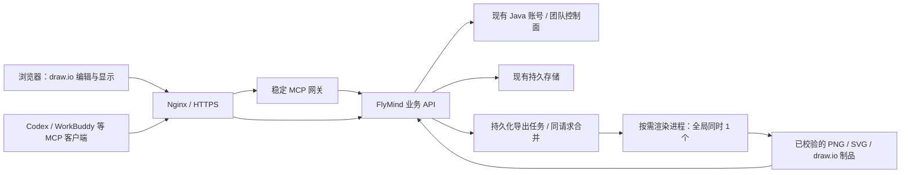

# FlyMind 低负载优化与上线方案

日期：2026-11-05。状态：待实施方案；没有据此启动实验、构建、提交、推送或部署。

最新容量约束：用户明确服务器最多只能提供1G空余，本方案统一按 **FlyMind网关、业务API、Java控制面和全部绘图子进程合计1GiB（1024MiB）硬上限** 设计，覆盖下文原先的2GiB预算。已有共享数据库若不在FlyMind进程组中，其增量占用必须另行核查，不能因此宣称整机已满足预算。云端现有导出池已经串行执行，新增队列并不能单独解决一个任务的内存峰值。

## 1. 本次决策

**保留现有 draw.io、工作台和业务能力；生产机只运行已构建制品。采用“轻量接入与业务服务 + 全局串行、按需启动的渲染进程 + 有定额的发布与制品管理”。**

默认使用 GitHub 托管 Linux runner 构建、验证、生成部署包，Actions 的发布任务只传包、验包、排空和切换。可以由独立 Linux 本地构建环境生成同格式包，再交 Actions 晋级；不在生产机运行 npm/pnpm install、Vite、TypeScript、Maven、浏览器安装、Docker build 或完整测试。也不把生产机注册为构建用 self-hosted runner。

本轮只交方案，后续实施和发布须按用户指令推进。之前的无限期优化目标已停止，不自动恢复。当前工作区已有大量未提交改动，不能整树打包上线。

### 保留的功能

- MCP 首次安装、OAuth 授权、固定远程地址、绘图规范与云端持续更新。
- 内容与渲染分层、既有图形类型和质量规范、AI 新建时按任务分组。
- 网页创建、自由编辑、自动保存、横竖布局、导入、导出、回收站。
- 原生可编辑 draw.io 文件、PNG、离线 SVG、JSON；原中文、图片、公式和手工布局能力。
- 前后台独立账号、团队、空间、操作记录与同图协作。

不以减少功能、调低输出质量、跳过鉴权/字体/资源检查、取消浏览器 sandbox 或伪造完成状态换取低占用。

## 2. 为什么此前没有有效收敛

| 问题 | 本次纠正 |
|---|---|
| 把单次未知口径的 1.06 GiB 与不同组件、系统的内存数字比较 | 固定输入、版本和拓扑；分别记录服务进程组、全部 FlyMind 和整机，禁止拼接不同测试数字 |
| 把本机有限内存下的实验水位当成整个产品交付的唯一目标 | 本机测试预算与生产容量验收分开；完整集成在独立 CI 验证环境完成 |
| 反复修改 viewer、CDP、字体和测试工具，但没有形成默认可用实现 | 当前 viewer/CDP/固定字体例外均停留为研究资料，不进入首轮发布必需范围 |
| 每遇到失败就扩展实验和发布状态机，范围持续增长 | 每个任务先写交付物与通过条件；最多两次无收益尝试，随后给出选择，不继续自动延长 |
| 用很多单测通过来代表完整可用 | 最终门槛是用户登录、MCP 绘图、浏览器编辑、导出、协作、升级和回滚的真实闭环 |
| 发布目录保留完整包、完整展开树、旧版本和重复 JAR，缺少统一容量策略 | 先分清代码、临时文件、可重建导出和用户数据；新发布流程执行容量预检、引用检查与保留策略 |

已证实的代码事实：旧云启动保留 Chromium；当前本地候选加入空闲回收、流式读写和 SVG 字体封装优化。控制面曾在成功后保留完整候选，当前候选加入了本次成功后的清理。截图不足以确定服务器每个目录的真实内容或可回收字节，也不能证明主机卡死一定由 OOM 导致。

真实源码依据：`server/cloud/start.ts`、`server/cloud/export-pool.ts`、`server/rendering/renderer.ts`、`server/application/native-exports.ts`、`server/exports/artifacts.ts`、`deploy/cloud/promote.mjs`、`deploy/cloud/control-plane-promote.mjs`、`scripts/build-cloud-bundle.mjs` 与现有 Actions。

## 3. 运行结构：先把主机保护好



### 3.1 轻量常驻部分

网关仅做协议、授权转交和当前规则取得；不静态加载绘图引擎、图片库、浏览器或团队数据库。业务 API 管理文档、权限、修订、协作和队列。Java 控制面继续复用，不在本次重写账号/团队系统，不新建第二套 MySQL/Redis。

前端由 Nginx 发送构建后的静态文件。打开已保存图形只需读取文档并在用户浏览器中渲染，**不得顺带在服务器生成 PNG 或启动 Chromium**。保持既有编辑器会话复用、静态资源缓存、草稿及保存保护；登录和含权限的数据不做跨用户公共缓存。

### 3.2 把重活从 API 生命周期移出

第一轮保留已实现的 Playwright + 固定 draw.io 原生渲染；不把尚未通用验证的 CDP/viewer/固定样本字体注入设为默认。

将渲染器及其专用依赖放到可退出的 worker 进程，常驻API不再经传递导入加载Playwright、sharp与浏览器。由现有持久任务队列提交不可变文档快照，worker 负责浏览器、原生 PNG/SVG、字体封装与原有完整PNG/资源校验。worker 与全部浏览器后代属于同一个受限进程组/cgroup；退出后其私有内存由操作系统回收。任务租约、幂等、取消、结果登记和用户权限仍由 API 维护。

worker没有业务数据库写权限，仅写本任务私有临时目录；它交回的同一组文件在父进程核对快照、长度和摘要后才登记为成功，不能校验一份Buffer却写入另一份。这样可以在确认归属后终止整棵worker进程树，而不强杀正在提交数据库的API。worker的停止超时、整组终止和残留确认单独配置；不能把当前API服务的排空配置原样复制给它。依赖和sandbox能力在独立验收及目标机首次启动时检查并释放验证进程，缺失时拒绝绘图就绪；健康轮询不反复启动浏览器。

调度规则：

1. 整个服务部署只允许一个重型渲染任务运行，不是每个团队各启动一个。编译、自动排版和导出重活使用统一准入，避免两个独立池各自认为“只跑一个”。
2. 首轮最多等待 8 个任务；每账号最多 1 个运行、2 个等待，团队公平轮转。合并相同快照的相同计算，队列满返回稳定繁忙状态，不无限加任务或自动重试。
3. 单任务从被执行到退出的硬截止暂定 60 秒；排队等待单列显示，不用长时间占住 API 请求。取消后必须确认 worker/浏览器实际退出，再腾出计算槽。
4. worker 空闲最多 5 秒可复用后退出；如果上一任务触发压力、退出不明或校验失败，立即隔离，禁止复用或启动第二棵替代浏览器。
5. 任务失败只影响该任务与绘图就绪状态，列表、登录和已授权读取继续可用。清理状态不明时关闭渲染准入，并提供可定位的错误与恢复记录。
6. 保留现有资源校验、字体完整回退、导出尺寸预算、512 MiB 启动准入和128 MiB运行期压力保护。具体生产限额要按整个 worker cgroup 计算，不能只看 Node 主 PID。

进程隔离需要实际实现和联测，不能仅启动一个 child 就称完成：IPC 输入/输出有上限，监听取消与超时，先写临时文件再校验登记；不让长 Base64/全部制品在多个进程间反复复制。文件交接只限本任务私有目录，路径、摘要、修订与租约均需验证。

### 3.3 少做重复工作

增加与用户交付分离的计算缓存，键至少包含：工作区、不可变快照摘要、完整渲染选项、渲染代码与引擎/字体供应摘要。不能只按图形 ID 或修改时间缓存。

同键在途计算合并；已校验制品复用前重新核查权限和当前请求的修订。不同用户/团队、版本、字体、背景或 scale 不混用。导出时间仍取本次交付时间，不能改图形创建/修改时间；下载名与交付清单可以更新，但不篡改原有成功任务的不可变回执。

新建或 AI 生成一次需要返回 PNG 的请求仍由服务端 worker 完成，**不要求用户先打开网页或启动本地应用**。本地 Agent 安装和云端规则持续更新仍走固定 `/mcp`，正常业务发布不要求客户重新填写配置。

## 4. 生产资源预算与是否适合共机

依据此前用户提供的4核4GB主机及最新“最多1G空余”约束制定预算；不是当前实测或性能承诺。实施前只读盘点OS、systemd/cgroup和已有服务，不假定还可以额外取得512MiB机器余量。

| 范围 | 工程验收目标/限制 |
|---|---|
| MCP网关、API、Java控制面等常驻部分合计 | 优化目标不超过320MiB；尚未证明可达到，先实测再决定单进程额度 |
| 一个完整重型任务带来的附加占用 | 目标不超过576MiB，计入其Node、Chromium、字体/图片处理子进程及被计费的文件缓存 |
| FlyMind正常工作合计 | 目标不超过896MiB，保留约128MiB内部余量 |
| 全部FlyMind服务及后代 | 父cgroup硬上限1024MiB，不能给每个服务分别配1GiB |
| 重型任务并发 | 整套部署同时最多1个；排版、渲染与封装使用同一流水线准入 |
| 等待队列 | 初始最多8个等待任务，持久化到库，只执行时加载完整快照；满额明确提示繁忙 |
| 发布接收/校验/解包 | 目标不超过256MiB，与绘图执行互斥，也计入该1GiB预算 |

这些数值是通过条件，不是已经测得的占用。不能把独立实验的489MiB与其他组件RSS直接相加当成同时发生的峰值。JVM `-Xmx`与Node heap参数也不是整个进程或进程组的内存限额；不能为了凑320MiB而让Java无法正常工作。

当前已有的`CloudExportPool`在单个应用实例中串行执行导出，`HeavyWorkRunner`另有自身串行队列，但排版/编译重活可能与浏览器导出重叠。因此应统一计算准入，而不是再套一层无界队列。一个绘图任务中的SVG封装是该任务自己的阶段，要能继续执行，不能因同一串行锁发生重入死锁。已排队任务不能被每个客户端自动重试复制成更多任务。

生产使用支持且验证有效的systemd/cgroup，父slice建议`MemoryHigh=896M`、`MemoryMax=1024M`，限制包含全部服务和后代；渲染子组限制不得让原512MiB启动准入无条件无法通过，须同时核查父、子组实际余量。交换策略只针对新增FlyMind组核查，不修改整机已有swap。若目标系统不支持这些属性，先验证等效限制。硬限制是保护主机的最后防线，可能终止任务，不能将“没有超过1G但任务一直失败”认定为优化完成。[systemd资源控制说明](https://www.freedesktop.org/software/systemd/man/247/systemd.resource-control.html)

若常驻部分无法降到可容纳单任务的水平，或者规定的复杂图在1GiB总预算下不能完成，就判定当前同机拓扑不通过；须选择外置渲染执行或进一步精简运行架构后再评估，不继续重复试参数，也不擅自将预算改回2GiB。网站、账号和固定MCP地址保持兼容，任何拓扑调整需在发布前说明。

用户此前提出的本机800MB可用内存约束继续用于本地开发/验证调度；完整Java、数据库及浏览器联测放在独立CI环境。它与4GB生产整机的容量指标分别验收，不能再把本机实验的560 MiB监督水位直接当成生产系统的唯一交付条件。

## 5. 磁盘：限制增长，不冒险删数据

### 5.1 发布产物分开，避免反复展开整个应用

构建环境产出可独立验证的应用包、控制面包和渲染运行时包；manifest 记录同一提交、依赖锁、OS/架构、Node ABI、组件与引擎供应摘要。应用包不再为单次Java更新携带并展开完整浏览器，控制面更新也不再为取一个JAR物化整棵应用树。

固定 Chromium/draw.io/字体供应随独立渲染运行时版本部署，网页所需 draw.io/字体资源由稳定只读版本路径提供。URL绑定内容摘要并长期缓存，旧标签页及回滚版本仍能取得原资源。API、网关和后台包不各自复制一份浏览器。

这要求明确组件引用并改造现有完整候选格式及校验器；**不能直接把当前 resources 目录改成外部 symlink、硬链接或不经校验的全局目录。** 第一版采用受限发布器管理的独立、root只读目录与显式版本绑定，保留完整清单验证和备份。暂不引入只读镜像挂载、fs-verity或复杂自动GC作为上线前置。

### 5.2 新流程的保留策略

| 内容 | 策略 |
|---|---|
| 应用/控制面代码 | 默认只保留当前、一个已验收回滚版本、一个正在接收/待晋级候选 |
| 渲染运行时 | 保留当前与回滚必需的供应；历史任务真实引用额外保留，引用不明时不删 |
| 成功部署的上传压缩包与展开临时目录 | 成功回执落盘并确认可重放后清除，只处理本流程拥有的路径 |
| 不确定/失败部署现场 | 保留并阻止下一次占用叠加；由恢复流程处理，不按时间直接删锁或候选 |
| 日志 | 只对FlyMind独立日志做轮转，初始总量上限200 MiB、时间上限7天；必要事件摘要另行保留 |
| 可重建导出缓存 | 初始总量上限512 MiB，按最久未用淘汰；正在交付、运行任务及成功任务引用的制品不误删 |
| 原始图形、SQLite/WAL、账号团队数据、数据库 | 永久业务数据，不进入发布目录清理或缓存淘汰 |
| 业务备份 | 独立配额和保留期；先验证外部备份及恢复，再审定本地过期策略，不与纯代码包一起删除 |

缓存与不可变成功任务的制品必须分别管理：如果成功任务长期保留文件读取能力，就不能把其文件直接当缓存淘汰。需先定义历史制品的明确保留期、再生成入口及用户可见状态；当前兼容性未审定前保留原制品并限额阻止新增，不能静默返回404。

工程门槛：代码与运行时稳定占用目标不超过2.5 GiB；发布相关目录硬预算暂定3 GiB，**不含用户数据和数据库/备份**。实际包测量若超标，先调包结构或修订有依据的预算，不伪造数字。保留引用超过上限时停止新发布并给出引用清单，而不是不断积累或直接删除。新候选接收前计算归档、展开空间、回滚和安全余量，释放空间后再接收；上传与解压都只有一个待发布槽位。

现有数GiB历史目录只读清点后单独处置；用户计划删除线上应用，也必须先确认哪些图形和账号数据需要保留并验证备份。此方案不授权任何生产删除。

## 6. 本地/CI构建与标准部署包

推荐主路径：开发机完成代码和低占用验证 → 获准提交 → GitHub托管Linux构建 → 独立CI运行完整业务与资源验收 → 固定制品 → Actions受限部署。

可选本地路径：使用与生产兼容的Linux容器/WSL或独立Linux构建机，运行相同build入口并生成相同manifest；Java、前端、依赖安装串行，产物交CI核验后进入同一Actions晋级流程。本机只有800MB余量时不强行进行完整构建/浏览器矩阵，完整构建使用托管runner。Windows的`node_modules`、sharp/better-sqlite3原生库或Chromium不能直接打进Linux生产包。

构建环境应固定与目标兼容的OS/libc、CPU架构、Node版本/ABI、Java和Chromium/Playwright版本。固定版本继续沿项目锁文件，不在本次顺带升级。依赖/浏览器/系统库在构建阶段准备好，生产只验证不下载；Playwright官方说明版本及浏览器依赖必须匹配。[Playwright环境说明](https://playwright.dev/docs/docker)

计划交付结构（尚未新增这些脚本，不要当成现有命令执行）：

```text
release-<commit>/
  release.json                 # 组件关系、兼容性、迁移级别、来源
  SHA256SUMS
  app.tar.gz                   # 网页、API；仅生产依赖
  control-plane.tar.gz         # JAR和构建后的管理端
  renderer-<supply-hash>.tar.gz # worker、原生依赖、浏览器、字体和资源
  verify-report.json           # 功能、性能、质量和资源测试结果
  install-report.schema.json   # 固定安装回执结构
```

包中排除源码测试矩阵、`output/`、探针、录屏、编译缓存、Maven/pnpm/npm缓存、用户数据库与凭据。必需许可证、运行时清单和原生依赖不能因瘦包被删。包与清单使用SHA校验，并绑定获准的提交/Actions run；生产使用已审定的固定发布工具，不执行归档里任意install脚本。[GitHub制品传递说明](https://docs.github.com/en/actions/tutorials/store-and-share-data)

## 7. 低负载上线流程

1. **上线前核查**：只读检查目标主机、磁盘/内存余量、OS兼容性和现有安装；明确数据保留及备份。账号/token只在受限环境配置，不进仓库。
2. **构建与验证在服务器之外完成**：全包只构建一次，生成唯一摘要；受限发布job只接收已通过验证的制品，不能在生产补编译或补装依赖。
3. **发布串行化**：Actions使用同一个production concurrency组，`cancel-in-progress:false`；服务端发布锁也保留。Actions不同时在4GB主机新起一套完整staging。环境与并发组是GitHub已有发布控制能力。[GitHub发布控制](https://docs.github.com/en/actions/how-tos/deploy/configure-and-manage-deployments/control-deployments)
4. **维护与排空**：拒绝新的重型任务，暂停晋级期间的写入并让协作客户端保留草稿、明确重连；排空既有任务。超过排空期限就终止本次晋级，保持原版本，不直接杀掉未知写入者。
5. **接收与校验**：一个包按块下载、摘要校验、顺序解压、验证完整文件清单；大文件不整块读入Node内存。不在生产跑五图导出或并行浏览器测试。
6. **备份与迁移**：停写后取得一致性备份；新增SQL必须经过清单审查、兼容性验证和备份恢复验证。上线优化批次尽量不混入业务数据库迁移。
7. **原子切换并顺序启动**：旧服务排空退出后切换版本，先账号控制面、再API，网关仅在自身变化时更新；避免旧新Java/API/渲染器并存。单独渲染器无任务时不拉起Chromium。
8. **轻量线上确认**：健康、实际登录/权限、文档读取、固定MCP连接、版本摘要、静态资源。若需要一次真实小图烟测，使用事先约定的专用验收账号与图形，不循环创建或压测生产。
9. **成功提交与清理**：成功回执及目录落盘，解除维护；再清理本次临时包与无引用旧代码。配额不满足或任何状态不明则留现场和锁，不能报告成功。
10. **上线后观察**：至少24小时低频采样，记录服务进程组峰值、空闲驻留、worker退出、错误率和磁盘增长；异常时通知，不循环重启或重复部署。观察不能代替上线前验收。

生产下载GitHub如果不稳定，发布job可以通过现有受限通道推送同一已校验包；或使用已有受控制品镜像。只是传输路径变化，提交、摘要和发布器不变，不在故障中临时开放root shell或自动安装第二套代理。

## 8. 验收表：满足才发布

不承诺“任何复杂度都2秒”——不设图形/像素上限时无法验收。上线前冻结一份测试清单，保存真实输入XML/内容摘要、节点/边数、文字/图片/公式规模、运行选项和代码/资源版本。

| 门槛 | 具体检查 |
|---|---|
| 核心功能 | 新环境首次连接MCP→本人OAuth→任务分组→生成真实PNG及源文件；网页人工改节点/连线→保存→AI增量修改→重开；导入、回收站、团队权限、双人协作、后台登录分别通过 |
| 图形质量 | 覆盖流程、泳道、脑图、应用架构、数据流及技术架构；原文/换行/中文、图片、公式、颜色、手工尺寸和走线不退化。更改渲染方法时另做同系统同输入差分，不用假身份组件测试冒充产品 |
| 打开图形 | 预热后的正常切图，小图样本不超过1秒、复杂样本不超过2秒，终点为正确文档可编辑；首次下载引擎的冷启动单列，暂定不超过5秒。明确测试网络/客户端条件 |
| 新计算导出 | 在1个运行任务条件下，小图执行目标不超过5秒、复杂样本不超过15秒；排队等待单列。相同快照的复用计算不重新拉浏览器；超过60秒正确终止并可恢复 |
| 内存与CPU | 在生产相同限制的独立环境，按进程组采样；空闲/冷启动/复杂图/连续20次/失败取消均满足第4节目标，无OOM，无残留浏览器；同一时刻重型渲染最多1个 |
| 队列与压力 | 3个客户端并发：一个执行、其余有限排队；满额正确提示。绘图失败时仍能登录、列图和读取已有图；租约和重试不造成重复提交 |
| 数据与制品 | 未完成任务不会发布半张图；快照、源文件与图片一致；缓存不串团队、旧制品读取不静默失效；导出时间不修改文档时间 |
| 磁盘 | 全新安装及连续3次更新后，代码/运行时/临时包/日志符合预算；没有每更新一次再留一棵完整控制面候选。引用不明时安全阻断，而非删除数据 |
| 故障与恢复 | 渲染超时/进程退出/磁盘不足/包损坏/发布中断/回执sync失败/回滚失败均有确定状态；不释放未知任务的计算槽或部署锁 |
| 升级与回滚 | 独立环境完整演练一次升级与一次回滚；内容、MCP工具、授权和草稿行为符合契约，无数据库盲恢复。回滚版本与资源都可重新启动 |

完整链路和负载验收在独立CI/验收环境执行，不在生产压测，也不在只有800MB可用的开发机上并行堆叠Java/MySQL/浏览器。每项保留输入、实测结果和失败，不用通过数充当业务结论。

## 9. 回滚和停止条件

应用或渲染器启动失败、健康检查超时、MCP授权/导出不通、图形质量回归、超预算或磁盘增长失控时，停止晋级。服务状态已确认、数据库迁移允许向后兼容时，排空新写入后切回唯一已验收旧版本和对应渲染供应；核对版本摘要、授权及文档读取。

存在未知子进程、systemd操作仍可能运行、写入未排空、迁移不兼容或回执不确定时，保留锁与现场进入维护，不盲目回滚/删锁。数据库不会随代码回滚自动恢复旧备份。详见[恢复约束](DEPLOYMENT_RECOVERY.md)。

## 10. 实施任务、顺序与时间上限

下面是待实施的人工工作量预估，不是已完成状态或确定交付时间。复用已有代码能缩短部分工作；真实容量不够需要外置渲染时另列变更，不持续耗时试参数。

| 顺序 | 可验收交付物 | 预估 | 阶段通过条件 |
|---|---|---|---|
| P0 冻结范围 | 保留当前dirty补丁；列明上线候选包含/排除文件，冻结6类代表输入、现状与主机需求 | 1–2小时 | 不再自动运行旧探针；每个改动都有对应功能或资源目标 |
| P1 离线打包 | 固定Linux构建入口、现有形态基线包与manifest、Actions构建/晋级分离 | 3–5小时 | 生产无需安装/编译；同一个基线包可在隔离环境安装、启动和卸载代码而保留数据 |
| P2 运行负载 | worker进程边界、全局串行和有界队列、进程组预算、已有流式/回收改动审查 | 8–12小时 | 真实MCP与网页导出闭环，超时/取消后无残留，服务不被渲染拖死 |
| P3 存储治理 | 基于P2形成最终组件包、资源引用、保留规则、容量预检、部署/日志清理、制品与缓存权限 | 4–6小时 | 最终包可离线安装；连续3次更新不无界增长，业务数据与回滚引用受到保护 |
| P4 集成验收 | 第8节完整报告及升级/回滚演练 | 4–6小时 | 必须项全部通过；失败按原任务修复，未通过不发布 |
| P5 发布 | 经授权的Actions晋级、轻量线上确认及回执 | 0.5–1小时，另24小时观察 | 版本、核心链路、资源与清理记录可复核 |

预计约3–4个工作日有效工作量，先交P0/P1的具体包与容量报告；不是先连续研究数天再汇报。每阶段超过预估上限50%时，说明已经完成的交付物、唯一阻断及两个可选处理，不继续自行扩题。

开发时最多复用两名 `gpt-6.1-terra / xhigh` 代理：一个负责worker/运行限制，一个负责包/存储；主代理控制范围和最终集成。共享重型测试串行，本机保持预算。每阶段只运行所需关联测试一次，新增失败或变更后再重测相关范围，不反复全套刷测试数。实验必须提前有假设、成功条件与停止条件；没有会改变路线的新证据就停止。

## 11. 当前交接：已有候选不等于可发布

- 可审查复用：空闲浏览器回收、取消后的队列隔离、有界流式读写、SVG字体封装、网关轻量导入、控制面本次成功清理、发布子进程/回执/恢复保护。各自局部证据见[U40状态](../validation/u40-status.md)与[存储记录](../validation/u40-storage.md)。仍需按本方案收敛成同一版本完整验收。
- 暂不进入生产：`scripts/probes/`的viewer/CDP、chrome=0、固定样本字体注入、按固定SHA放行data URL及截图替代PNG。部分小图成功不是通用质量证明，复杂链路还有未通过项。
- 不混入：其他任务PRD/图片、本地旧图恢复数据、用户数据库、测试输出、历史临时构建与无关传输草稿。
- 尚未完成：默认worker独立进程交付、完整缓存契约、组件发布格式、统一保留配额、完整栈1GiB总预算与质量验收、实际生产发布。

完成定义只有一个：**客户首次安装并授权MCP即可绘图；用户能在原工作台继续编辑和导出；服务器在规定负载下保持可用，内存、CPU与磁盘不随任务和发布次数失控增长，并能安全升级和回滚。**
