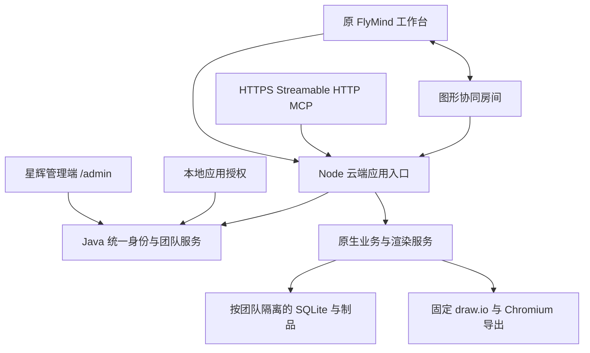

# FlyMind 账号、团队与线上协作实施方案

日期：2026-10-19。状态：实施基线，尚未交付线上版。本文为现有 PRD/技术设计的新增范围，不改变已发布本地 1.0.0 的事实。

用户随后明确：**尚未准备服务器，先交付可部署版本。** 本批交付完整可部署应用、启动配置及初始化/备份/使用文档；真实公网发布推迟到用户提供目标后执行。保留线上产品架构和全部账号/团队/协同/MCP目标，不把仅本机演示当成可部署版本。

## 1. 用户目标与边界

1. 保留当前 FlyMind 工作台和 draw.io 编辑体验，增加面向用户的登录及团队入口。
2. 本地应用也需要授权登录；本期采用账号密码路线，复用统一账号，不另外建立一套注册码账号。
3. 复制用户提供的星辉管理系统，在副本上开发；后台本期只开放用户、团队及必要的权限管理。
4. 同一用户可以加入多个团队；成员共同访问同一张图，并可同时编辑。不是仅共享链接或保存时提示冲突。
5. 线上提供一个 HTTPS MCP 地址，客户端完成授权后可以创建、读取、修改图形并获得真实图片和编辑链接。
6. 网页、MCP 和团队成员修改同一份数据，继续严格区分业务内容层与渲染层。
7. 本批交付经过验证的可部署版本及安装、接入、部署、备份和使用说明；真实线上发布按用户最新决定暂缓。

不在本批引入内置模型 API Key、支付套餐、素材市场或另一个画布引擎。已有用户数据不自动上传、不自动合并。

## 2. 当前证据

- 当前 FlyMind 是本机单用户 Node/Vue/SQLite 服务；HTTP 入口主动拒绝外部主机，不能直接公开到互联网。
- 已有 `NativeDiagramService`、`NativeExportService`、原生 MCP、CAS、幂等与导出队列可复用。
- 星辉正式源码分为两个独立仓库：`UI` 和 `springboot-admin-xinghui/xinghui-admin`；提供目录本身不是 Git 仓库。
- 星辉已有用户、JWT/Redis 登录、权限及租户能力；单个用户只有一个 tenantId，不能把租户页面当成多团队管理。
- draw.io 固定 31.5.3 资源包含嵌入 diffSync、getDiff、patch、resetDiff；多人并发的实际收敛行为必须通过双客户端验证。
- 当前未发现已部署的团队服务或远程 MCP。Docker 引擎当前未运行；尚未获得线上部署目标。

审计依据：[后台复用](ADMIN_REUSE_AUDIT.md)、[引擎与远程接入](ENGINE_CLOUD_AUDIT.md)。文档中的建议接口不代表已经可用。

## 3. 产品流程

### 3.1 账号与本地授权

一期沿用星辉的账号体系，用户以账号密码登录；账号开通、停用、重置由管理后台处理，邀请可以绑定已有账号。注册入口只有实现了真实校验和落库后才开放，不能沿用仅打印表单的旧页面。

本地入口通过浏览器完成统一登录，获得绑定应用/设备的授权。账号密码不落入本地配置或 MCP 配置；本地令牌与已有 Runtime 私有目录隔离存放。失效、退出、停用后拒绝继续读取与修改，不只在网页上遮住按钮。离线授权宽限尚未定义，本期不宣称无限离线可用。

### 3.2 团队与权限

登录 → 个人空间/选择团队 → 团队图形列表 → 新建或打开 → 编辑/AI 修改 → 保存修订 → 导出。

| 角色 | 允许操作 |
|---|---|
| 平台管理员 | 开通/停用账号，管理团队状态及必要的成员支持；敏感管理操作留审计 |
| 团队所有者 | 管理团队及成员、转移所有权、创建/修改/删除/恢复图形 |
| 团队管理员 | 邀请与管理普通成员、管理图形，不移除最后一位所有者 |
| 编辑者 | 读取、创建、编辑、分组、导出图形，无成员管理权 |
| 查看者 | 读取和导出，不可修改画布、内容、分组或回收站 |

团队与系统租户分开建模。团队邀请绑定随机一次性凭证、有效期及角色上限；成员退出或移除立即失去新请求及协同房间访问权。团队暂停后拒绝成员写入及 MCP 写入。团队销毁为独立确认动作，不能连带删除其他团队或个人空间。

### 3.3 多人编辑

打开图形 → 校验团队身份和角色 → 加入图形房间 → 读取快照与序号 → 增量同步 → 服务器验证并落库 → 广播已提交变更 → 客户端确认已保存。

两人改不同元素应保留双方改动；同一元素冲突遵循明确的确定性策略；删除与重连不能产生损坏文档。断线期间保留本机草稿，重连先取缺失变更再重基。不能用循环重载 XML 造成闪屏或丢失视口。撤销仅撤销本人的相应操作，不能撤销其他成员的后续编辑。

AI 修改经过相同的团队权限及修订协调入口。AI 不提交坐标，服务增量更新内容和渲染后向在线客户端广播；不得跳过正在进行的人工修改直接全量覆盖。

### 3.4 远程 MCP

用户将 `https://<域名>/mcp` 加入客户端 → 浏览器登录与授权并选择团队 → MCP 获得限定团队和用途的令牌 → 读绘图标准 → 创建/修改 → 返回真实 PNG、受保护的制品资源和网页登录链接。

编辑 URL 不携带长期 Bearer token。制品必须在同一团队权限下读取；需要临时下载链接时绑定制品和短有效期，不能列举其他资源。现有本机 URL 和 STDIO 安装继续按原文档标识，不能当成远程 MCP。

## 4. 技术结构

### 4.1 控制面与数据面

- 复制目录为工作区 `xinghui-admin/frontend`、`xinghui-admin/backend`。保留两份正式源码及许可，不复制 Git 元数据、依赖、构建输出、个人配置、凭据或业务数据库；记录文件摘要与源版本。
- Java 是账号、用户状态、团队、membership 与授权事实来源；复用已有用户及权限服务，补齐团队业务表和应用授权接口。不能在 Node 重新维护一套同名用户密码表。
- 新增 Node cloud 入口，复用原业务服务。当前本机 Runtime 继续保持本机访问限制，不能简单取消 Host/Origin 校验后上线。
- Node 按服务器确认的团队 ID 映射独立 `DiagramStore`、导出队列与制品目录。客户端提交的路径、teamId 或 diagramId 不能绕过 membership；相同图形 ID 可以安全存在于不同团队。
- 首期单台持久化服务，WAL 数据库保存在持久卷；禁止多副本同时挂载同一 SQLite 工作区。以后需要横向扩展时再迁移数据层，不把单机 WAL 描述为分布式数据库。
- 浏览器 Cookie 会话与远程 MCP 授权分开：Cookie HttpOnly/SameSite、CSRF 与来源校验；MCP 走授权码 + PKCE S256、资源受众、权限范围、过期和撤销，提供标准发现元数据。不能把后台管理 JWT 原样透传给任意工具或上游。
- MCP 会话绑定用户和团队，切团队需重新绑定授权，工具参数不能临时切换租户。

### 4.2 同步层

优先使用固定版本公开嵌入增量接口，协同层独立于内容模型。先验证真实双客户端，再冻结房间序号、重基、确认、冲突和本地撤销协议。业务保存仍做原生投影校验与原子修订，不允许只广播而不落库。

不能因公开 diff 接口存在就宣称自托管默认支持实时协作。官方自托管版本不提供开箱即用实时协同服务；本项目须补服务与验证。[draw.io 官方说明](https://github.com/jgraph/drawio/wiki/FAQ#does-self-hosting-include-real-time-collaboration)

远程授权以 [MCP 官方规范](https://modelcontextprotocol.io/specification/2025-11-25/basic/authorization)及已安装 SDK 为准，先验证发现、授权、刷新、撤销及越权，再写用户接入说明。

### 4.3 上线边界

同一 HTTPS 域名反向代理 `/` 工作台、`/admin` 管理端、`/mcp`、认证/团队 API 与同步连接。数据库/Redis 不公开端口；供应固定引擎、浏览器和中文字体，线上 Linux 出图必须单独验证。配置从环境变量/受限密钥文件提供，不复制源项目的开发凭据。

备份覆盖控制面数据库、团队工作区和制品清单，恢复在独立目录演练。上线前必须确认域名、服务器、TLS 与运行方式；当前仍等待部署目标，不能把本地联调地址宣称为已发布。

## 5. 执行顺序与负责人

固定复用 `dev_application`（gpt-6.1-sol / medium）和 `dev_engine`（同配置）。主代理负责契约、审查、退回及独立验收。各阶段先有可运行切片，不把全部文档或历史 D07/G2 当成新目标前置。

| 阶段 | 应用代理 | 引擎代理 | 主代理验收 | 通过条件 |
|---|---|---|---|---|
| C00 规划与源码复制 | 后台审计、源码复制、摘要清单 | 当前接口/供应/同步审计 | 路线与来源核对 | 正式源码副本可追溯，无旧数据或凭据混入 |
| C01 账号与团队闭环 | Java 应用授权/团队接口、用户团队后台和登录/切团队 | 可信团队上下文、独立工作区与云端 API | 双用户/双团队真实请求 | 登录、停用、邀请、角色、团队隔离均真实落库 |
| C02 在线绘图与 MCP | 原工作台云端适配、团队入口 | HTTP MCP/OAuth、共享服务、固定出图 | 真客户端建图/图片/编辑/导出 | 单 URL 授权调用，网页和 MCP 修改同图且双向可见 |
| C03 同图实时协同 | 原工作台同步接入及成员状态 | diffSync 协议、房间持久日志与重基 | 双浏览器 + AI 交替与同时编辑 | 不同元素、同元素、删除/重连、Undo、断线重连均有明确正确结果 |
| C04 本地授权与部署交付 | 本地登录入口、部署包/配置及文档 | 本地 Runtime/MCP 服务端授权校验、部署平台渲染 | 隔离环境完整集成、部署启动与恢复演练 | 本地登录不可绕过，可部署制品能在隔离环境完整启动和运行；公网按用户决定后续执行 |

协同能力探针可以与 C00 的复制并行；只有验证后的协议进入产品。每批交付记录修改文件、执行结果、风险、起止与返工原因。未通过的验收不能写成已完成。

## 6. 集成验收与完成证据

| 需求 | 必须检查的证据 | 当前状态 |
|---|---|---|
| 复用管理系统 | 实际源码副本、摘要清单、独立构建、用户/团队页面真实 API | 进行中 |
| 用户授权 | 正确/错误密码、退出/停用/过期、多设备、权限撤销 | 待实现 |
| 本地授权 | 无登录不能从网页、STDIO MCP 或直接 API 绕过；登录后正常绘图 | 待实现 |
| 团队协作 | 成员邀请/接受/移除、角色、切团队、最后所有者保护 | 待实现 |
| 数据隔离 | 两团队相同图形 ID，交叉读取/写入/下载/恢复/同步均被拒绝 | 待实现 |
| 云端绘图 | 五类创建、保存/重开、AI 增量修改、真实 PNG/SVG/源文件 | 待实现 |
| 实时同图编辑 | 独立双浏览器同时改动与断线重连，不丢双方有效操作 | 待验证协议 |
| 单链接 MCP | 官方客户端授权发现→PKCE→tools→图片，过期刷新与撤销 | 待实现 |
| 可部署交付 | 实际构建制品、独立部署启动、双账号编辑/调用、持久化重启与恢复、操作文档 | 待实现/验收 |
| 真实公网发布 | 实际域名 HTTPS 与远程业务核验 | 用户明确暂缓，待准备服务器后执行 |

正式完成以当前文件、真实服务及上述证据为准；本次按用户最新决定验收可部署交付，不宣称已公网发布。任何未完成项保留在本表和任务台账，不通过缩小绘图/协同/授权链路宣布完成。
