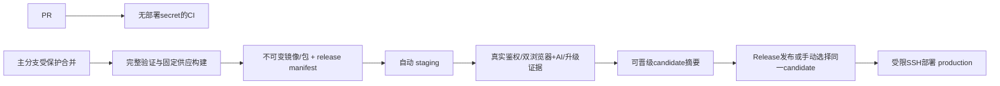

# v1.1 GitHub 自动部署方案（待 SSH 探测与实施）

日期：2026-10-20。状态：方案经PM定点复核，实际配置和部署待SSH探测及实施验收，**没有启动、部署或启用工作流**。用户尚未提供目标服务器。本文件和 [workflow示例](examples/cloud-deploy.disabled.example.yml) 仅位于 docs；示例首job恒失败，不可直接作为生产流水线。

## 1. 交付目标与当前事实

v1.1 包含账号/授权、团队、同图多人实时编辑、人和MCP共用修订，以及固定HTTPS `/mcp` 的服务端持久更新。C03协同不是可选后续。保留原UI与业务/渲染分层，公共URL、OAuth issuer/resource稳定；更新过程不要求客户改配置，仍需如实处理断连、重新初始化或授权失效。

本方案遵循 [v1.1主计划](../releases/V1_1_PLAN.md)，并补充 [MCP更新策略](../MCP_UPDATE_STRATEGY.md)。v1.1交付与部署验收包含完整C03实时协作；更新策略中的历史范围表述不缩减该目标。

只读核查：

| 当前来源 | 事实 / 不能据此承诺的能力 |
|---|---|
| `.github/workflows/ci.yml` | Windows runner、Node22，npm ci→供应setup→build→test；这是本地Windows包验证，不是Linux云部署验证；actions目前为可移动v4 tag |
| 当前质量分支 | npm包 `os:win32`；没有完整云Dockerfile、发布/排空脚本、正式云服务启动装配或可直接部署的v1.1制品 |
| 冻结 `codex/cloud-collaboration-20261020` | Node cloud/OAuth/团队根、Java控制面、协同核心探针等在研成果；不能直接部署该旧分支覆盖质量1.1；需合并后完整验收 |
| Java复制源码 | `integrations/xinghui-admin/backend/pom.xml` 为Spring Boot3.3.6、Java17编译目标，现有依赖管理含MySQL驱动；未据此指定生产MySQL/Redis镜像版本 |
| 固定渲染资源 | draw.io31.5.3、字体Noto Sans CJK SC固定SHA、playwright-core1.62.1、Chromium151.0.7922.34/rev1234；Linux共享库、沙箱、目标CPU尚未实测 |
| 原生依赖 | 本机SQLite addon实测匹配Node20.19.6；换PATH Node24/其他ABI会失败。生产应在目标Linux/CPU/同Node ABI镜像内npm ci并验addon，绝不复制Windows node_modules |

以上版本为审计基线，不在本文自动改版本、生成tag或承诺云Linux已经受支持。

## 2. 流水线与触发



- **PR只CI**：不获取部署密钥、不访问生产、不运行特权 `pull_request_target` 来执行PR代码。现有Windows CI保留；未来另加目标Linux与Java、MySQL/Redis隔离集成、真实供应出图、协同与旧契约回归。
- **主分支验证成功后自动staging**：构建一次并发布候选，自动部署到独立staging数据根/数据库；不接生产卷。确切受保护分支名待维护者确认，不能直接部署任意手动ref或冻结试验分支。
- **生产由Release或手动选candidate触发**：只晋级已经过staging的同一manifest与镜像digest，不现场重新build。Release事件本身作为发布入口；不把“每次再点一次环境批准”作为硬前置。GitHub Environment人工review可按团队需要开启。
- GitHub `staging/production` 分开配置来源分支与secret。环境保护通过后job才取得该环境secret；review能力受仓库公私属性和套餐限制，SSH后核实实际账户权限，不能假定任何仓库都有审批。[GitHub环境保护](https://docs.github.com/en/actions/reference/workflows-and-actions/deployments-and-environments)
- 部署组 `cancel-in-progress:false`，不能新提交一来就取消正在备份/切写入者的发布。Actions默认最多一个pending且可替换；官方现有 `queue:max` 也有上限/入队排序边界。生产仍由远端锁、release序号/当前版本校验防重入和过时发布，GitHub队列不充当可靠发布账本。[GitHub并发规则](https://docs.github.com/en/actions/how-tos/write-workflows/choose-when-workflows-run/control-workflow-concurrency)

## 3. 不可变制品与供应

建议OCI镜像作为首选，离线不可变包作为受控替代。SSH识别目标后再决定Docker/Compose或systemd；不假定已安装Docker，不为方案先在用户机器安装。

候选manifest至少包含：

```text
releaseId, sourceCommit, contractVersion, policyBundleHash, migrationLevel
gatewayImageDigest, applicationImageDigest, javaImageDigest, webAssetsDigest
engineResourceKey, drawioVersion/archiveSHA, fontSHA/licenseSHA
browserVersion/revision/platform/archiveSHA, nativeAddonABI, Node/JDK版本
collabProtocolVersion, eventLogSchemaVersion, supportedPreviousClientVersions
CI run/source repository identity, staging evidence digest, rollbackCompatibility
```

- CI从确切commit构建；规则/schema/说明/校验器同包。production使用 `image@sha256:...`，不依赖可变latest标签；tag仅便于人查看。[Docker按digest拉取](https://docs.docker.com/reference/cli/docker/image/pull/)
- 同一候选原样晋级staging→production，不能分别构建两份；多平台镜像记录manifest digest及实际平台子镜像digest，不把amd64验证冒称arm64通过。
- GHCR构建job仅给所需 `contents:read/packages:write`；生产机器只读拉取。GitHub Actions优先短期GITHUB_TOKEN；服务器私有GHCR如需凭据使用独立read-only凭据/凭据助手，不把CI写包token常驻服务器。[GitHub Container registry](https://docs.github.com/en/packages/working-with-a-github-packages-registry/working-with-the-container-registry)
- action启用前从官方仓库核对源码并锁完整commit SHA；Docker基础镜像也固定digest。样例不猜checkout/build/SSH第三方action版本，不在本批添加供应链依赖。[GitHub安全建议](https://docs.github.com/en/actions/reference/security/secure-use)
- draw.io WAR/许可证、字体/许可证按现SHA复用；目标浏览器必须有平台对应固定包与摘要。镜像构建阶段准备/校验，生产启动不临时下载latest或fallback机器Chrome。保留第三方许可、SBOM与验收记录。
- Node20.19.6只是在研SQLite已验证基线，不等于长期生产版本承诺；部署前选择仍受维护且项目可用的Node精确版本，在目标平台重建better-sqlite3/sharp，运行真实SQLite读写/备份与PNG/SVG测试。当前Windows-only包限制和源码运行入口需在正式云制品中明确适配，不能用 `npm --force` 当Linux兼容证据。
- Java镜像编译/运行JDK、MySQL/Redis小版本与持久化策略待现机探测和兼容测试后固定；不执行复制项目中继承的旧初始化脚本或示例连接配置。

## 4. 服务、权限与数据目录

规划单机首期：TLS反向代理 → 稳定Node MCP网关/网页 → 单活Node绘图应用、协同room与固定worker；Java控制面 → MySQL/Redis。**网关/绘图应用分离、发布维护状态及room排空目前均待实现**。

| 持久对象 | 建议位置/权限（路径为方案，不执行创建） |
|---|---|
| 发布manifest与不可变版本记录 | `/opt/flymind/releases/<releaseId>`，root管理，deploy用户不可任意改写 |
| 独立环境数据 | `/var/lib/flymind/{staging,production}/...`，各自服务UID；cloud团队SQLite/历史/制品/幂等回执不能混本机根 |
| 固定供应 | 镜像只读层或按engineResourceKey只读目录，保留被旧任务引用版本 |
| MySQL/Redis持久卷 | 独立服务UID与私网，仅正式Java/运维访问；不向公网开放3306/6379 |
| 应用secret | root管理的 `/etc/flymind/<environment>/` 或正式secret manager，0600，容器只读secret挂载；不进入镜像/build arg/仓库/前端 |
| 备份 | 独立加密目标，有限保留、恢复演练；不以CI artifact保存含用户数据的全库备份 |

Linux沙箱须用非root与经过目标环境验证的浏览器沙箱/namespace配置，限制worker内存、CPU、并发/像素/超时、出站网络、私有tmp。本项目Linux启动分支尚未显式开启 `chromiumSandbox:true`；固定Playwright1.62.1本地源码 `coreBundle.js:43075` 在非true时添加 `--no-sandbox`，这是源码审计事实而非Linux实际启动证据。不因“能截图”就接受互联网多租户生产安全，需单独审定隔离边界。

实际装配时固定非敏感配置 `FLYMIND_CLOUD_PUBLIC_ORIGIN`、`FLYMIND_CLOUD_CONTROL_PLANE_URL`、`FLYMIND_CLOUD_DATA_DIR` 与内部bind/port；外部HTTPS origin和反代Host精确匹配。控制面走固定受信任HTTPS origin，不能为图省事把任意私网HTTP放进开发回环豁免，也不能开启本机Runtime的对外监听来代替云入口。

部署SSH账号不能root登录、不能加入具root级能力的docker组。只允许固定dispatcher管理既定服务与路径，不接受任意shell/Compose文件/卷路径/下载URL。Docker官方明确docker组具有root级权限。[Docker Linux权限](https://docs.docker.com/engine/install/linux-postinstall/)

## 5. SSH后首批只读探测

先取得主机范围与只读账号授权，记录脱敏结果；发现已有服务/数据即保留，不直接执行安装或重启。

1. OS发行版、内核、CPU架构、内存/磁盘/inode、容器/虚拟化、时钟；不猜Ubuntu或amd64。
2. 现有监听端口/反代站点/防火墙、TLS域名和证书续期方式；只读查看服务名/路径，不导出带secret的完整env/Compose/日志。
3. systemd/Docker/Compose/Node/npm/JDK/MySQL/Redis/SQLite版本、运行UID、服务依赖、健康/重启策略；不无条件升级。
4. 已有应用目录、卷挂载、数据根/WAL/备份位置、磁盘余量与权限、符号链接、是否网络共享卷；只统计/核对，不读取用户业务正文。
5. 出站可达GHCR/GitHub固定资源、镜像代理；Linux浏览器共享库/沙箱支持。先只读检测库是否存在，实际启动在后续隔离staging验收，不在只读阶段运行浏览器。
6. GitHub仓库是否包含Java与Node的正式集成源码、环境保护可用性、包访问权限、runner到服务器网络与可信host fingerprint来源。
7. 若服务已存在，探测窗口、备份责任人、停机预算、紧急恢复入口、RPO/RTO；最终实际路径/端口/镜像/启动单元由PM确认后落配置。

## 6. Secret与SSH信任

| 名称 | 存储位置 | 用途 |
|---|---|---|
| `DEPLOY_SSH_KEY` | GitHub各Environment secret，staging/prod分钥 | 仅发布dispatcher；仅该job临时0600文件，结束删除 |
| `DEPLOY_KNOWN_HOSTS` | GitHub各Environment secret/受保护配置 | 管理员带外核对fingerprint后固定；禁止部署时ssh-keyscan即信任或关闭StrictHostKeyChecking |
| `DEPLOY_HOST/DEPLOY_PORT/DEPLOY_USER` | GitHubEnvironment variables | 非secret地址参数，严格格式验证；不写用户凭据 |
| `REGISTRY_PULL_TOKEN`（确有需要时） | 服务器secret manager/专用registry助手 | 仅read:packages，不借CI写权限；不传进浏览器 |
| `FLYMIND_GATEWAY_KEY` | Node/Java运行时同环境secret | 至少32字节随机，共同内部授权，staging/prod不同；不进入GitHub发布清单 |
| MySQL账号密码、Redis认证、加密/会话密钥、备份密钥 | 服务器secret manager，按服务最小权限 | 不在GitHub build job保存生产业务secret；不记录真实值 |
| CI临时测试账号/测试环境密钥 | 仅隔离测试/Environment secret | 不使用管理员生产密码做流水线smoke，不发布包含token的截图/trace |

服务器 `authorized_keys` 使用 `restrict,command="...dispatcher..."` 等受控策略，禁PTY/转发；dispatcher对 `SSH_ORIGINAL_COMMAND` 作精确语法解析，仅接受 `promote <environment> <releaseId> <manifestSHA>` 和单独授权的rollback命令。禁止eval、任意相对路径、任意shell字符串；必要sudo仅固定root-owned脚本，无通用sudo权限。[OpenSSH authorized_keys规则](https://man.openbsd.org/sshd.8)

## 7. 受限发布脚本状态机（尚未实现）

1. 取得服务器级部署锁，验证environment、候选release/manifestSHA、受保护source commit与staging证明；拒绝过时/重入发布。不能只信workflow传来一个SHA，需校验候选来自受信任CI的manifest/签名或attestation。
2. 按digest预拉镜像、检查供应/迁移兼容与空间，**新应用不挂生产写卷预热**；staging使用独立数据根，不复制用户库到CI。
3. 网关通知维护，停止新业务写入/新room加入，保持MCP接入与登录；不伪装成功，不为HTTP失败自动重放写操作。
4. 按下一节排空协同room和持久任务；确认已接收操作全部提交或可重放，记录最后revision/room序号、writer epoch、幂等回执与lease。正常已有请求有截止时间，超时保留可恢复状态。
5. 备份所有明确团队库及业务制品一致引用、Java身份授权数据库和必要Redis持久状态；记录备份清单/摘要、release/migrationLevel和恢复点，完成恢复可读核验后才进入迁移。
6. 停旧writer/worker，关闭SQLite handle并确认旧进程退出/实例锁释放；无法确认则停留维护、不得起第二writer。获取独占fence后才启动新应用/room，接管queued与过期lease任务，保留旧供应。
7. 定向健康与真实业务smoke通过后开放room/写入，写入发布审计。SSH或CI中断时服务器状态机继续收敛或明确维持维护；不依赖长驻SSH shell存活作为事务保证。
8. 失败先确认新writer已停，再回退旧代码/网关兼容路由；没有数据schema兼容证明不得直接回退。不可逆迁移需单独批准维护和恢复流程；不得回滚整库覆盖发布后新用户写入。保留失败卷副本供诊断，恢复演练不指向原库。

SQLite备份使用在线Backup API或已停写/关闭后的完整一致快照，不裸拷贝正在写入的 `.sqlite` 并遗漏WAL；WAL与原库不能随意分离，不能将共享网络卷蓝绿双写当集群。[SQLite Backup API](https://sqlite.org/backup.html)、[SQLite WAL](https://sqlite.org/wal.html)

MySQL与SQLite之间没有现成跨库原子事务；共同维护窗口记录恢复点，身份/grant/成员事实与图形恢复需分别校验，恢复后重新验证令牌，不能承诺两份独立文件天然形成全局一致快照。Redis是否可重建/是否承载room日志必须按最终实现定案，不能默认 `FLUSHALL`。

## 8. 多人房间、未确认编辑与长连接发布

v1.1上线前必须实现并验收，不能用单机CAS/刷新替代：

- room固定team/diagram和有序seq/revision，收到的操作及ACK进度、去重键、必要outbox持久可恢复；MCP与人同一应用服务/提交序列。若无法恢复已ACK操作，禁止部署晋级。
- 排空发布room维护/epoch边界：客户端先提交活动文字并将本地未ACK操作保存在恢复草稿，服务端完成已接收提交；未获ACK仍显示待同步/重连，不显示已保存。离线客户端不能假称完成排空，新实例须兼容其base/seq并重基或明确冲突，保留原草稿，不覆盖远端。
- 关闭旧room前记录sealed sequence/writer epoch与持久revision；新room通过fencing接管，拒绝旧owner迟到广播/写入。恢复后按原operation/requestId补ACK和重放，不从旧XML全量覆盖最新图；Undo仍只撤自己的操作，不吞远端编辑。
- 应用发布可短暂维护而接入网关不重启；绘图服务的room长连接可有界重连，需保留未确认编辑。仅升级网关时另排空MCP会话/授权连接；旧内存session不在新进程假复活，404后按实际客户端行为重新initialize，地址/授权主体不变。
- WebSocket作为拟实现room传输之一，最终路径/协议待实现固定；当前不是已有生产WS服务器。Nginx需要显式转发Upgrade/Connection，设置心跳和经验证read timeout；MCP Streamable HTTP/SSE需要关闭缓冲/缓存、允许流式GET/POST/DELETE，保留Host/Origin/Authorization/Mcp-Session-Id/协议版本与Last-Event-ID，不能把OAuth/room token放URL。[Nginx WebSocket官方说明](https://nginx.org/en/docs/http/websocket.html)
- 无论WebSocket还是其他room传输，都要验证同源/会话权限、消息大小、速率与连接预算；重连不跳过授权。反代TLS正确传递外部Host，后端只信受控代理的转发头，不通过放宽本机Runtime Host规则实现公网。

## 9. staging/生产发布门槛

**仅200健康页不算通过**。分开liveness与readiness；readiness核对release/policy/resource/collab协议/数据库migrationLevel/单活fence，公网上仅公开安全摘要。实际健康路径尚待实现，不能把本机 `/studio-api/health` 当全云就绪证明。

staging必须提供：

1. 真实Java/MySQL/Redis登录、团队隔离/角色、OAuth DCR+PKCE+refresh/revoke、编辑/制品链接，无stub/共享开发token后门。
2. 真实MCP五型创建、PNG/SVG/drawio下载、revision/文件摘要/时间一致；规则1.1坏例拒写，保存响应断开后原requestId不重复建图，旧输出schema兼容。
3. **双浏览器+AI同时编辑同图跨一次升级**：不同字段可合并、同字段明确冲突，复制/删除/重连与本地Undo不丢远端，断网/未ACK恢复；跨团队及撤权立刻拒绝。
4. 升级中至少一个room有待ACK操作，一个MCP写响应中断，一个queued/running导出；升级后两端native完整签名/内容及服务修订一致，原任务按原供应继续，不生成第二张图。
5. 同一固定MCP配置连续两次升级；网关仅在自身发布时排空，旧客户端重连/列表刷新实际验证；新网页不强制reload正在编辑iframe。
6. 一次失败回滚/恢复演练，确认不丢新修订/回执/成员与grant事实、不出现双writer，不对production执行故障注入。

生产完成受限账号的隔离smoke后留观察窗：ACK延迟/冲突/重连率、MCP错误、队列积压/lease、出图时延、单活状态、DB/备份错误与磁盘；无自动“健康失败就恢复旧数据库”的动作。RPO/RTO与维护窗口待SSH后的容量和演练结果确定，不编造指标。

## 10. 启用条件与本批交付

样例在 docs下且恒失败；没有新增 `.github/workflows`、Dockerfile或服务器deploy脚本，也未执行SSH。SSH只读探测后，先形成实际环境清单，再由PM批准制作容器/启动单元、受限dispatcher、备份、健康/room排空与真实CI流水线。审核官方action commit、制品来源/晋级验证、环境secret及权限后，才复制并修改为可启用workflow；不得只删掉首个exit就用于生产。

本文件为部署设计和来源核对，不代表冻结协作分支、Linux运行时或v1.1已验收。没有服务器不阻挡后续可部署制品开发；真正公网发布在主机/域名/TLS和完整验收就绪后执行。
